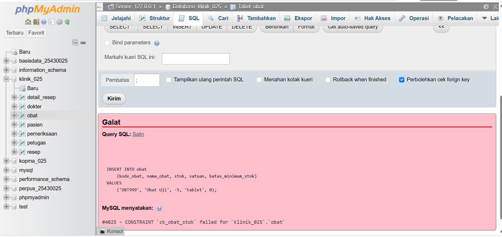

# Laporan Praktikum Basis Data - Pertemuan 5

**Nama:** Mutiara Icha Yani  
**NIM:** 25430025  
**Kelas:** A   
**Tanggal:** 19 Oktober 2026

## 1. Tujuan Praktikum

Praktikum ini bertujuan memahami penggunaan Data Definition Language (DDL) untuk membuat dan mengubah struktur basis data, menerapkan *primary key* dan *foreign key*, menggunakan *constraint*, serta menguji perubahan struktur tabel dengan perintah `ALTER TABLE`.

## 2. Ringkasan Dasar Teori

- **CREATE TABLE:** digunakan untuk membuat tabel baru.
- **ALTER TABLE:** digunakan untuk mengubah struktur tabel.
- **PRIMARY KEY (PK):** menjadi identitas unik setiap baris.
- **FOREIGN KEY (FK):** menjaga hubungan antartabel.
- **CHECK:** membatasi nilai berdasarkan kondisi tertentu.
- **UNIQUE:** mencegah nilai duplikat pada kolom yang ditentukan.
- **ON DELETE SET NULL:** mengatur nilai *foreign key* menjadi `NULL` ketika data induk dihapus, jika kolom mengizinkan `NULL`.

## 3. Hasil Langkah Percobaan

Bagian ini berisi dokumentasi hasil percobaan DDL, pengujian constraint, dan perubahan struktur tabel. Screenshot disimpan di folder `laporan/img/`.

### 3.1 Pengujian Kode Barang Duplikat

**Keterangan:** Gambar ini menunjukkan pengujian ketika kode barang yang sama dimasukkan kembali. Constraint `UNIQUE` digunakan untuk mencegah adanya kode barang yang duplikat.

### 3.2 Pengujian Stok Negatif

**Keterangan:** Gambar ini menunjukkan pengujian nilai stok negatif. Constraint digunakan untuk memastikan nilai stok sesuai dengan aturan yang telah ditentukan.

### 3.3 Pengujian Foreign Key Penjualan

**Keterangan:** Gambar ini menunjukkan pengujian relasi *foreign key* pada tabel penjualan. Relasi ini memastikan data yang dirujuk sesuai dengan data pada tabel induk.

### 3.4 Pengujian Foreign Key Detail Resep

**Keterangan:** Gambar ini menunjukkan pengujian relasi *foreign key* pada tabel detail resep. Relasi tersebut menjaga hubungan data detail resep dengan tabel yang berkaitan.

### 3.5 Pengujian Stok Minimum

**Keterangan:** Gambar ini menunjukkan pengujian nilai stok minimum. Constraint digunakan untuk membatasi nilai agar sesuai dengan ketentuan yang diterapkan.

### 3.6 Struktur Tabel Obat

**Keterangan:** Gambar ini memperlihatkan struktur tabel obat, termasuk kolom, tipe data, dan aturan yang diterapkan pada tabel tersebut.

### 3.7 Pengujian Constraint Stok Minimum

**Keterangan:** Gambar ini menunjukkan pengujian constraint stok minimum untuk memeriksa apakah aturan yang ditetapkan dapat diterapkan dengan benar.

### 3.8 Pengujian Jumlah Obat pada Resep

**Keterangan:** Gambar ini menunjukkan pengujian jumlah obat pada detail resep. Pengujian dilakukan untuk memastikan jumlah obat memenuhi aturan yang ditentukan.

### 3.9 Pemeriksaan Constraint Stok Barang

**Keterangan:** Gambar ini memperlihatkan pengujian aturan stok barang untuk menjaga agar nilai stok sesuai dengan ketentuan basis data.

### 3.10 Penambahan Kolom Menggunakan ALTER TABLE

**Keterangan:** Gambar ini menunjukkan penggunaan perintah `ALTER TABLE` untuk menambahkan kolom pada tabel yang sudah dibuat.

## 4. Jawaban Titik Analisis

**1. Mengapa primary key diperlukan?**

*Primary key* menjadi penanda unik untuk setiap baris sehingga data dapat dibedakan dan dirujuk dengan jelas.

**2. Apa fungsi foreign key?**

*Foreign key* menjaga hubungan antartabel dan memastikan nilai referensi sesuai dengan data pada tabel induk, berdasarkan aturan relasi yang dibuat.

**3. Apa yang terjadi ketika data melanggar constraint?**

MariaDB dapat menolak operasi yang melanggar aturan seperti `CHECK`, `UNIQUE`, atau `FOREIGN KEY`. Pesan galat perlu diperiksa untuk mengetahui penyebab kegagalan.

**4. Apa perbedaan ON DELETE CASCADE dan ON DELETE SET NULL?**

`ON DELETE CASCADE` menghapus data terkait pada tabel anak ketika data induk dihapus. Sementara itu, `ON DELETE SET NULL` mengubah nilai *foreign key* pada tabel anak menjadi `NULL`, jika kolom tersebut mengizinkannya.

**Catatan:** Cocokkan kembali jawaban dengan pertanyaan Titik Analisis pada modul praktikum yang digunakan.

## 5. Hasil Latihan dan Modifikasi

Latihan DDL mencakup pemeriksaan struktur tabel, pengujian relasi, penerapan constraint, serta perubahan struktur menggunakan `ALTER TABLE`.

Pada latihan basis data Kopma, pengujian meliputi keunikan kode barang, nilai stok, *foreign key*, penambahan atau penghapusan kolom, dan aturan `ON DELETE SET NULL`.

Pada proyek Klinik Mutiara, pengujian difokuskan pada struktur tabel, relasi antartabel, serta aturan stok obat dan jumlah obat pada detail resep.

## 6. Tugas Mandiri: Milestone Proyek 5

### 6.1 Deskripsi Proyek

Proyek mandiri yang dikembangkan bertema **Klinik Mutiara** dengan nama basis data `klinik_025`. Basis data ini dirancang untuk mendukung pengelolaan informasi klinik, meliputi data pasien, dokter, petugas, pemeriksaan, resep, obat, dan detail resep.

### 6.2 Daftar Tabel Proyek Klinik

Tabel yang digunakan dalam proyek Klinik Mutiara adalah:

1. `pasien`
2. `dokter`
3. `petugas`
4. `pemeriksaan`
5. `resep`
6. `obat`
7. `detail_resep`

### 6.3 Struktur Tabel Proyek Klinik

**Keterangan:** Gambar ini menunjukkan struktur tabel obat, termasuk kolom dan tipe data yang digunakan.

### 6.4 Perubahan Struktur Tabel

**Keterangan:** Gambar ini menunjukkan perubahan struktur tabel menggunakan perintah `ALTER TABLE`.

### 6.5 Penerapan Constraint

**Keterangan:** Gambar ini menunjukkan pengujian constraint untuk memastikan data pada tabel obat mengikuti aturan yang ditentukan.

### 6.6 Pengujian Relasi Antartabel

**Keterangan:** Gambar ini menunjukkan pengujian relasi menggunakan *foreign key* pada tabel pemeriksaan.

### 6.7 Pengujian Constraint dan Pesan Galat

**Keterangan:** Gambar ini menunjukkan pengujian batas minimum stok untuk memeriksa apakah constraint berjalan sesuai aturan.

### 6.8 File Pendukung Proyek

File pendukung yang digunakan dalam praktikum:

- `p05_ddl_25430025.sql`
- `p05_ddl_kopma_25430025.sql`
- `p05_erd_fisik_25430025.drawio`

Pastikan semua file tersebut sudah tersimpan di repositori GitHub dan sesuai dengan hasil praktikum.

## ## 7. Pembahasan dan Kendala
### 7.1 Pembahasan

Pada praktikum pertemuan 5, saya mempelajari penggunaan perintah DDL untuk membuat dan mengubah struktur tabel pada basis data. Praktikum ini juga membahas penerapan *primary key*, *foreign key*, dan constraint untuk menjaga integritas data. Melalui pengujian perintah SQL dan `ALTER TABLE`, saya dapat memahami cara menambahkan aturan serta mengubah struktur tabel sesuai kebutuhan. Penerapan materi ini juga digunakan pada proyek Klinik Mutiara dengan basis data `klinik_025`, yang memiliki tabel pasien, dokter, petugas, pemeriksaan, resep, obat, dan detail resep.

### 7.2 Kendala

Kendala yang dibahas dalam praktikum ini berkaitan dengan pengujian perintah SQL dan penerapan constraint. Perintah dapat menghasilkan pesan galat apabila sintaks, struktur tabel, atau relasi antartabel belum sesuai. Untuk mengatasinya, saya perlu memeriksa kembali perintah SQL, tipe data, serta pengaturan *primary key* dan *foreign key*. Dari kegiatan ini, saya belajar bahwa ketelitian dalam menulis perintah SQL sangat penting agar struktur dan hubungan antartabel dapat dibuat sesuai kebutuhan.

## 8. Kesimpulan

Berdasarkan praktikum yang dilakukan, perintah `CREATE TABLE` dan `ALTER TABLE` digunakan untuk membuat dan mengubah struktur basis data. *Primary key*, *foreign key*, `CHECK`, dan `UNIQUE` membantu menjaga integritas data. Pengujian perintah SQL diperlukan untuk memastikan struktur tabel dan aturan relasi berjalan sesuai kebutuhan proyek.

## 9. Pernyataan Penggunaan AI

AI digunakan sebagai alat bantu untuk merapikan susunan laporan dan membantu menjelaskan konsep DDL. Isi laporan dan bukti screenshot perlu diperiksa kembali agar sesuai dengan kegiatan praktikum yang benar-benar dilakukan.

## 10. Bukti Git

**Repository:** https://github.com/mutiaraichayani-dotcom/basisdata-25430025
