# Laporan Praktikum Basis Data - Pertemuan 5

**Nama:** Mutiara Icha Yani  
**Npm:** 25430025  
**Kelas:** A
**Tanggal:** 19 Oktober 2026

## 1. Tujuan Praktikum

Praktikum pertemuan 5 bertujuan untuk memahami dan menerapkan perintah DDL (*Data Definition Language*) dalam pengelolaan struktur basis data. Praktikum ini juga bertujuan untuk memahami penggunaan *Primary Key*, *Foreign Key*, dan constraint seperti `CHECK` serta `UNIQUE`, melakukan perubahan struktur tabel menggunakan `ALTER TABLE`, dan menguji aturan integritas data pada basis data Kopma dan Klinik Mutiara.

## 2. Ringkasan Dasar Teori

DDL (*Data Definition Language*) merupakan kumpulan perintah SQL yang digunakan untuk membuat, mengubah, dan menghapus struktur objek dalam basis data.

Beberapa konsep yang digunakan dalam praktikum ini adalah:

- **CREATE TABLE** digunakan untuk membuat tabel baru beserta kolom dan aturan yang diperlukan.
- **ALTER TABLE** digunakan untuk mengubah struktur tabel, seperti menambahkan atau menghapus kolom dan constraint.
- **DROP TABLE** digunakan untuk menghapus tabel dari basis data.
- **Primary Key (PK)** merupakan kunci utama untuk membedakan setiap baris data dalam tabel.
- **Foreign Key (FK)** merupakan kunci yang menghubungkan tabel dengan tabel lain dan menjaga integritas referensial.
- **CHECK** digunakan untuk membatasi nilai yang dapat disimpan sesuai dengan kondisi tertentu.
- **UNIQUE** digunakan untuk memastikan nilai pada kolom tertentu tidak memiliki duplikasi.
- **ON DELETE SET NULL** mengubah nilai FK menjadi `NULL` ketika data induk dihapus, jika kolom FK mengizinkan nilai `NULL`.
- **ON DELETE CASCADE** memungkinkan data pada tabel anak ikut dihapus ketika data induk yang dirujuk dihapus.

Penerapan konsep tersebut membantu menjaga konsistensi dan integritas data dalam basis data.

## 3. Hasil Langkah Percobaan

Percobaan dilakukan menggunakan MariaDB melalui lingkungan XAMPP. Pengujian mencakup penerapan constraint pada database Kopma (`kopma_025`).

### 3.1 Pengujian Foreign Key

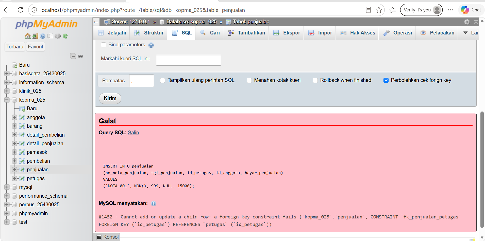

**Keterangan:** Pengujian dilakukan dengan memasukkan ID anggota yang tidak tersedia pada tabel induk. Sistem menampilkan pesan galat karena data tersebut tidak memenuhi aturan Foreign Key. Hal ini menunjukkan bahwa Foreign Key berfungsi menjaga integritas hubungan antartabel.

### 3.2 Pengujian Constraint CHECK

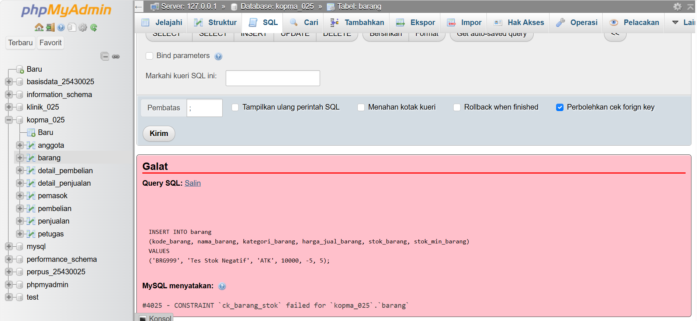

**Keterangan:** Pengujian dilakukan dengan memasukkan nilai stok barang negatif. Sistem menampilkan pesan galat karena nilai tersebut melanggar constraint `CHECK` yang membatasi stok agar tidak negatif.

### 3.3 Pengujian Constraint UNIQUE

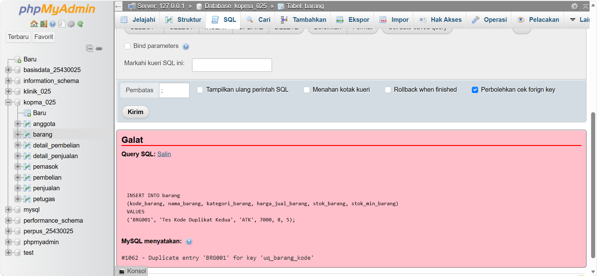

**Keterangan:** Pengujian dilakukan dengan memasukkan kode barang yang sudah digunakan. Sistem menolak data tersebut karena kode barang harus bersifat unik. Pengujian ini menunjukkan bahwa constraint `UNIQUE` berfungsi mencegah duplikasi nilai.

## 4. Jawaban Titik Analisis

### 4.1 Mengapa Foreign Key diperlukan?

Foreign Key diperlukan untuk menjaga hubungan antartabel. Dengan adanya Foreign Key, data pada tabel anak harus merujuk pada data induk yang sesuai sehingga hubungan antardata tetap valid.

### 4.2 Apa fungsi CHECK?

Constraint `CHECK` digunakan untuk membatasi nilai berdasarkan kondisi tertentu. Contohnya, stok barang tidak boleh negatif dan jumlah obat dalam resep harus lebih besar dari nol.

### 4.3 Apa fungsi UNIQUE?

Constraint `UNIQUE` digunakan untuk mencegah duplikasi nilai pada kolom tertentu, seperti kode barang. Dengan demikian, setiap barang dapat memiliki kode yang berbeda.

### 4.4 Apa fungsi ALTER TABLE?

`ALTER TABLE` digunakan untuk mengubah struktur tabel yang sudah ada, misalnya menambahkan kolom baru atau menghapus kolom yang tidak diperlukan.

### 4.5 Apa perbedaan ON DELETE CASCADE dan ON DELETE SET NULL?

`ON DELETE CASCADE` menghapus data pada tabel anak ketika data induk yang dirujuk dihapus. Sementara itu, `ON DELETE SET NULL` mengubah nilai FK pada tabel anak menjadi `NULL` ketika data induk dihapus, selama kolom tersebut mengizinkan nilai `NULL`.

## 5. Hasil Latihan dan Modifikasi

Bagian ini membahas latihan lanjutan pada database Kopma (`kopma_025`), khususnya perubahan struktur tabel dan penerapan aturan stok minimum.

### 5.1 Penambahan Kolom dengan ALTER TABLE

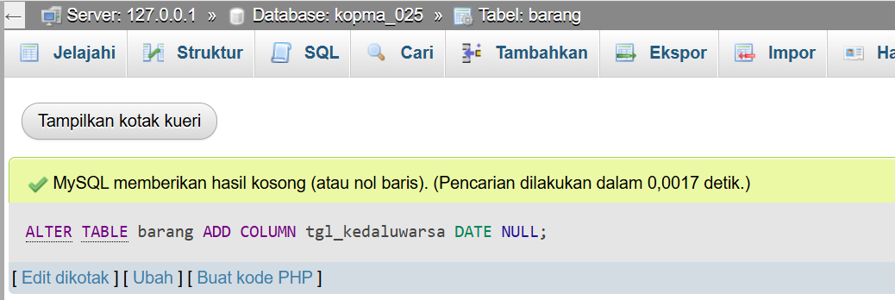

**Keterangan:** Gambar ini menunjukkan penambahan kolom `tgl_kedaluwarsa` pada tabel barang menggunakan perintah `ALTER TABLE`. Perintah ini digunakan untuk menyesuaikan struktur tabel dengan kebutuhan.

### 5.2 Penghapusan Kolom dengan ALTER TABLE

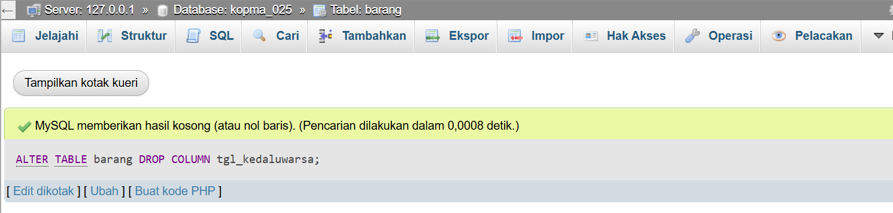

**Keterangan:** Gambar ini menunjukkan penghapusan kolom `tgl_kedaluwarsa` dari tabel barang menggunakan perintah `ALTER TABLE`. Percobaan ini menunjukkan bahwa struktur tabel dapat diubah sesuai kebutuhan.

### 5.3 Penambahan Constraint CHECK Stok Minimum

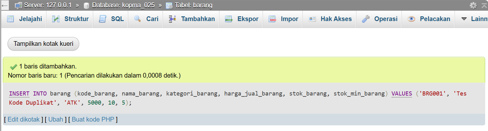

**Keterangan:** Gambar ini menunjukkan penambahan constraint `CHECK` untuk memastikan nilai stok minimum barang tidak negatif.

### 5.4 Pengujian Constraint CHECK Stok Minimum

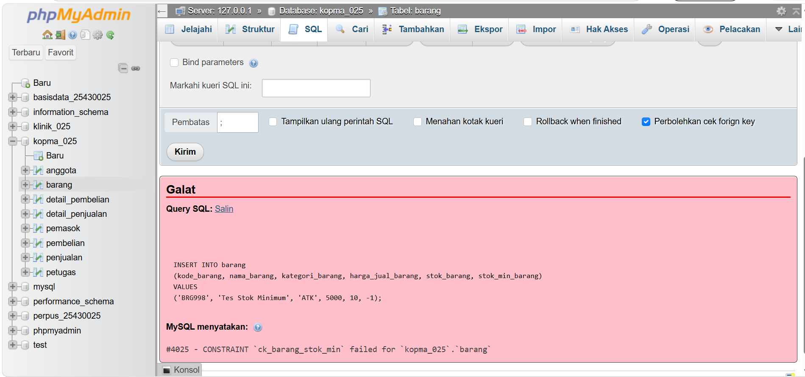

**Keterangan:** Pengujian dilakukan dengan memasukkan nilai stok minimum negatif. Sistem menampilkan pesan galat apabila nilai tersebut melanggar constraint `CHECK`. Hal ini menunjukkan bahwa aturan stok minimum diterapkan untuk mencegah nilai yang tidak valid.

## 6. Tugas Mandiri: Milestone Proyek 5

### 6.1 Deskripsi Proyek

Proyek mandiri yang dikembangkan bertema **Klinik Mutiara** dengan nama basis data `klinik_025`. Basis data ini dirancang untuk mendukung pengelolaan informasi klinik, meliputi data pasien, dokter, petugas, pemeriksaan, resep, obat, dan detail resep.

### 6.2 Daftar Tabel Proyek Klinik

Tabel yang digunakan dalam proyek Klinik Mutiara adalah:

1. `pasien`
2. `dokter`
3. `petugas`
4. `pemeriksaan`
5. `resep`
6. `obat`
7. `detail_resep`

### 6.3 Struktur Tabel Obat

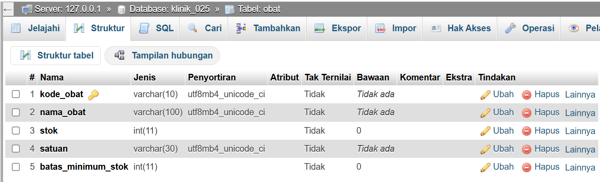

**Keterangan:** Gambar ini menunjukkan struktur tabel `obat` pada database Klinik Mutiara. Tabel ini digunakan untuk menyimpan informasi obat, termasuk identitas obat, jumlah stok, dan batas minimum stok.

### 6.4 Relasi Detail Resep

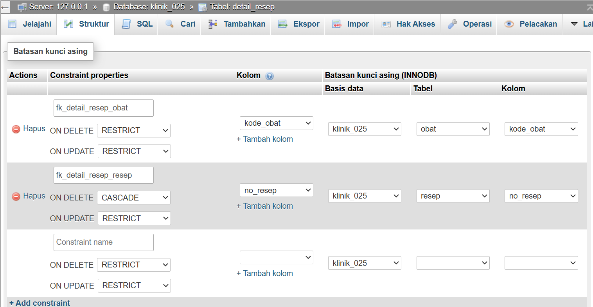

**Keterangan:** Gambar ini menunjukkan relasi tabel `detail_resep` dengan tabel terkait. Relasi tersebut digunakan untuk menghubungkan informasi resep dengan obat yang diberikan kepada pasien.

### 6.5 Foreign Key pada Tabel Pemeriksaan

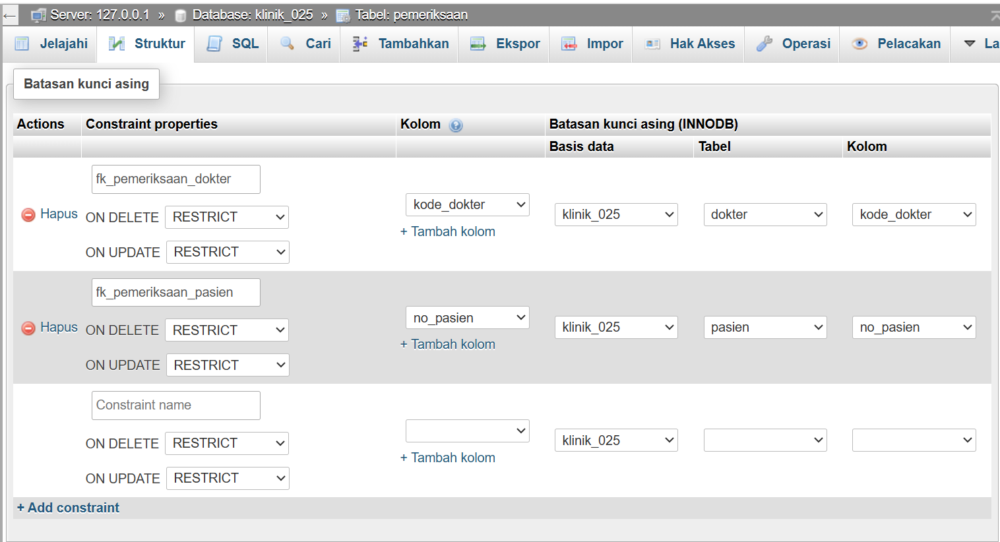

**Keterangan:** Gambar ini menunjukkan penerapan `FOREIGN KEY` pada tabel `pemeriksaan` untuk menghubungkan data pemeriksaan dengan data induk yang sesuai sehingga hubungan antartabel tetap terjaga.

### 6.6 Pengujian CHECK Stok Obat

**Keterangan:** Gambar ini menunjukkan pengujian constraint `CHECK` pada stok obat. Jika nilai yang dimasukkan melanggar aturan, sistem menampilkan pesan galat dan menolak data tersebut.

### 6.7 Pengujian CHECK Stok Minimum

**Keterangan:** Gambar ini menunjukkan pengujian constraint `CHECK` pada nilai stok minimum. Pesan galat menunjukkan bahwa nilai yang dimasukkan tidak sesuai dengan ketentuan yang ditetapkan.

### 6.8 Pengujian Batas Minimum Stok

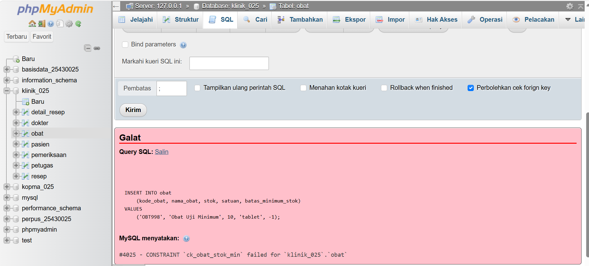

**Keterangan:** Gambar ini menunjukkan pengujian batas minimum stok pada tabel `obat`. Jika nilai yang dimasukkan tidak memenuhi aturan constraint, MariaDB menampilkan pesan galat dan menolak perubahan data.

### 6.9 CHECK Jumlah Obat pada Resep

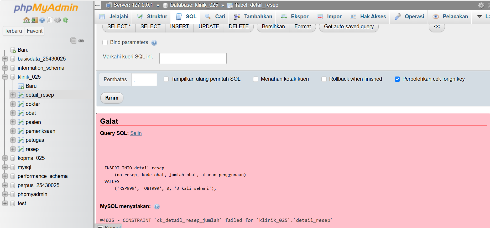

**Keterangan:** Gambar ini menunjukkan penerapan constraint `CHECK` pada jumlah obat di tabel `detail_resep`. Constraint ini digunakan untuk memastikan jumlah obat lebih besar dari nol sehingga data resep tetap valid.

### 6.10 Pengujian Foreign Key Detail Resep

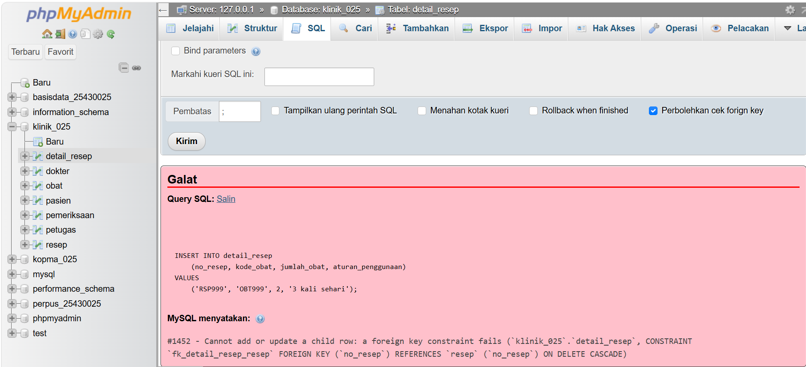

**Keterangan:** Gambar ini menunjukkan pengujian `FOREIGN KEY` pada tabel `detail_resep` dengan menggunakan data yang tidak memiliki referensi pada tabel induk. Jika sistem menampilkan pesan galat, berarti data tersebut ditolak karena tidak memenuhi aturan relasi.

## 7. Pembahasan dan Kendala
### 7.1 Pembahasan

Pada praktikum pertemuan 5, saya mempelajari penggunaan perintah DDL untuk membuat dan mengubah struktur tabel pada basis data. Praktikum ini juga membahas penerapan *primary key*, *foreign key*, dan constraint untuk menjaga integritas data. Melalui pengujian perintah SQL dan `ALTER TABLE`, saya dapat memahami cara menambahkan aturan serta mengubah struktur tabel sesuai kebutuhan. Penerapan materi ini juga digunakan pada proyek Klinik Mutiara dengan basis data `klinik_025`, yang memiliki tabel pasien, dokter, petugas, pemeriksaan, resep, obat, dan detail resep.
### 7.2 Kendala

Kendala yang dibahas dalam praktikum ini berkaitan dengan pengujian perintah SQL dan penerapan constraint. Perintah dapat menghasilkan pesan galat apabila sintaks, struktur tabel, atau relasi antartabel belum sesuai. Untuk mengatasinya, saya perlu memeriksa kembali perintah SQL, tipe data, serta pengaturan *primary key* dan *foreign key*. Dari kegiatan ini, saya belajar bahwa ketelitian dalam menulis perintah SQL sangat penting agar struktur dan hubungan antartabel dapat dibuat sesuai kebutuhan.

## 8. Kesimpulan

Praktikum pertemuan 5 memberikan pemahaman tentang penggunaan perintah DDL untuk mengelola struktur basis data. Penggunaan `CREATE TABLE`, `ALTER TABLE`, Foreign Key, `CHECK`, dan `UNIQUE` membantu menjaga struktur serta konsistensi data.

Melalui latihan Kopma dan proyek Klinik Mutiara, dapat dipahami bahwa setiap tabel perlu dirancang dengan hubungan dan aturan yang sesuai agar data dapat dikelola secara teratur. Pengujian dengan data yang tidak valid juga membantu memastikan bahwa aturan integritas diterapkan dengan benar.

## 9. Pernyataan Penggunaan AI

AI digunakan sebagai alat bantu untuk memahami konsep DDL, menyusun penjelasan hasil praktikum, dan merapikan dokumentasi laporan, serta pemeriksaan hasil dilakukan oleh praktikan sesuai dengan kegiatan praktikum.

## 10. Bukti Git

**Repository GitHub:**  
https://github.com/mutiaraichayani-dotcom/basisdata-25430025

Berkas yang berkaitan dengan praktikum pertemuan 4 meliputi:

- `p05_ddl_25430025.sql`
- `p05_ddl_kopma_25430025.sql`
- `p05_erd_fisik_25430025.drawio`
- `laporan/p05_laporan_25430025.md`
