# Laporan Praktikum Basis Data - Pertemuan 06

**Nama:** Mutiara Icha Yani    **NPM:** 25430025    **Kelas:** A    **Tanggal:** 8 November 2026    

---

## 1. Tujuan Praktikum

Pada pertemuan ini saya belajar mengisi basis data dengan `INSERT` (satu baris, banyak baris, dan `INSERT ... SELECT`), mengubah dan menghapus data dengan aman memakai `sql_safe_updates`, lalu membuktikan lewat skenario uji positif dan negatif bahwa data yang salah memang ditolak server. Hasil akhirnya adalah data sampel yang bisa dibangun ulang dari skrip, baik untuk studi kasus Kopma maupun proyek Klinik Mutiara.

## 2. Ringkasan Dasar Teori

- **Urutan pengisian.** Karena ada kunci tamu, tabel induk diisi lebih dulu, tabel anak sesudahnya. Penghapusan berjalan sebaliknya, kecuali relasi yang memakai `ON DELETE CASCADE`.
- **Bahaya `UPDATE`/`DELETE` tanpa `WHERE`.** Perintah seperti itu mengenai semua baris dan tidak memunculkan galat. `sql_safe_updates` membuat server menolaknya (ERROR 1175) kecuali `WHERE` memakai kolom kunci atau ada `LIMIT`.
- **Menguji basis data.** Uji positif memastikan data benar diterima. Uji negatif memastikan data salah ditolak dengan galat yang tepat. Setiap uji dicatat dengan format tetap (masukan, harapan, hasil nyata, status) supaya bisa diulang orang lain.

## 3. Hasil Langkah Percobaan

Basis data: `kopma_025`. Semua tangkapan layar memperlihatkan phpMyAdmin dengan basis data ber-NIM dan jam sistem.

### 3.1 Mengisi data induk (D.1)

Tabel `petugas` diisi 5 baris (K01 Dimas, K02 Sari, K03 Rina, G01 Joko, P01 Ketua Kopma) dengan satu `INSERT` banyak baris.

`barang` diisi 4 baris (ATK-001, ATK-002, MNM-001, MKN-001).

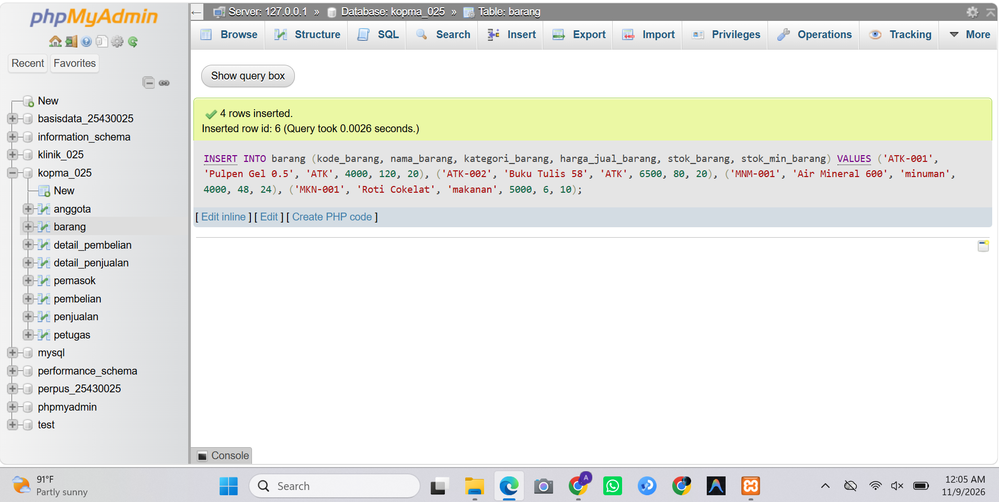

`anggota` diisi 3 baris: A001 dan A002 berstatus aktif, A003 nonaktif.

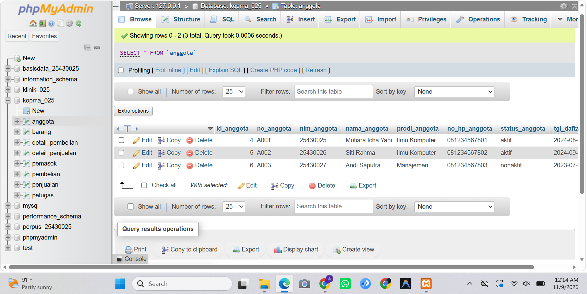

`pemasok` diisi 2 baris (PT Sumber ATK dan CV Berkah Jaya).

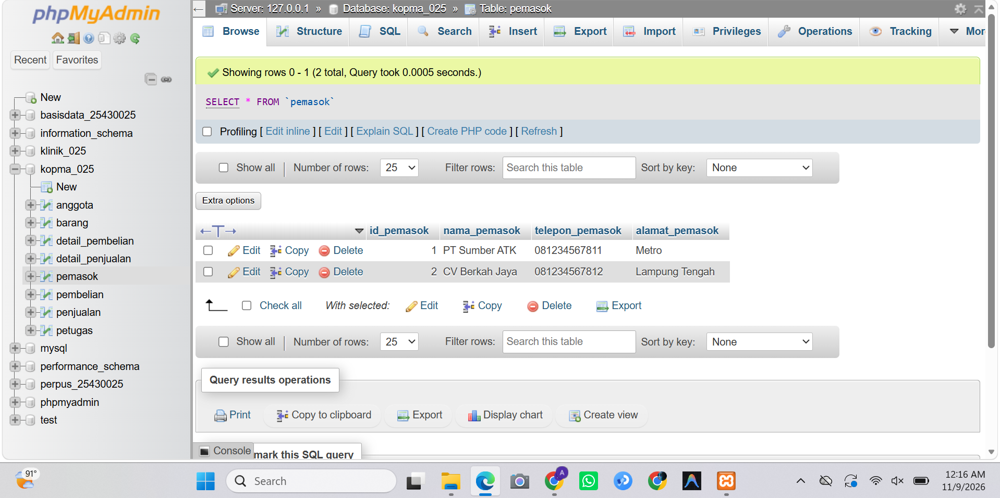

### 3.2 Mencatat nota penjualan (D.2)

Nota PJ-2609-0142 dicatat di `penjualan` (id_penjualan = 2, petugas K03, anggota A001, bayar Rp30.000). Detail pertama dimasukkan dengan `INSERT ... SELECT` supaya harga satuan diambil dari tabel `barang`, bukan diketik.

```sql
INSERT INTO detail_penjualan (id_penjualan, id_barang, qty_detail_penjualan, harga_satuan_detail_penjualan)
SELECT 2, id_barang, 3, harga_jual_barang FROM barang WHERE kode_barang = 'ATK-001';
```

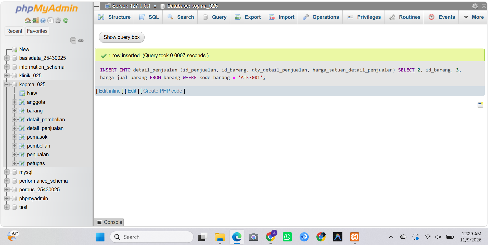

Dua barang lain ditambahkan pada nota yang sama, sehingga nota berisi 3 barang: Pulpen ×3 @4.000, Buku Tulis ×2 @6.500, Air Mineral ×1 @4.000 (total Rp29.000).

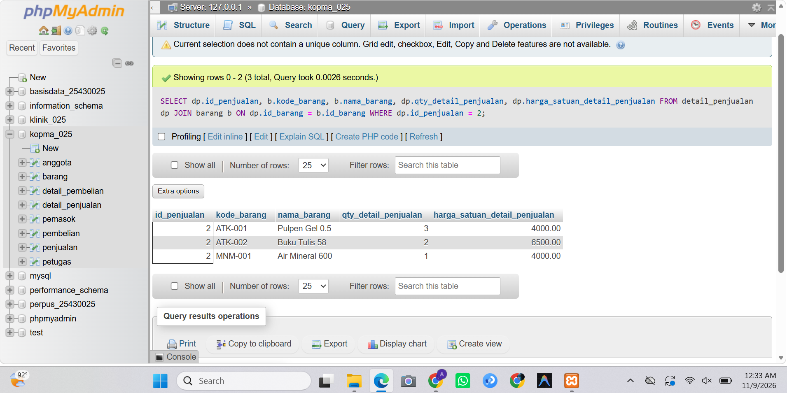

Stok dikurangi sesuai qty dengan `UPDATE ... WHERE id_barang = ...`. Stok sebelum penjualan 120, 80, 48 dan sesudahnya 117, 78, 47.

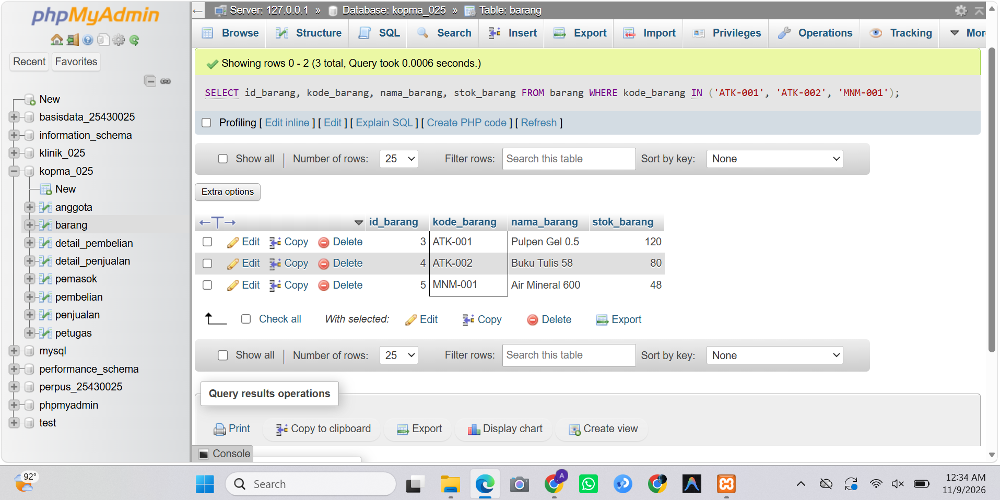

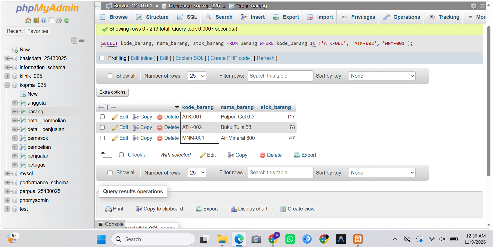

### 3.3 Mengubah dan menghapus dengan aman (D.3)

Mode aman diaktifkan lalu `UPDATE` tanpa `WHERE` dicoba. Server menolak dengan ERROR 1175.

```sql
SET SESSION sql_safe_updates = 1;
UPDATE barang SET harga_jual_barang = harga_jual_barang;
-- #1175 - You are using safe update mode and you tried to update a table without a WHERE that uses a KEY column
```

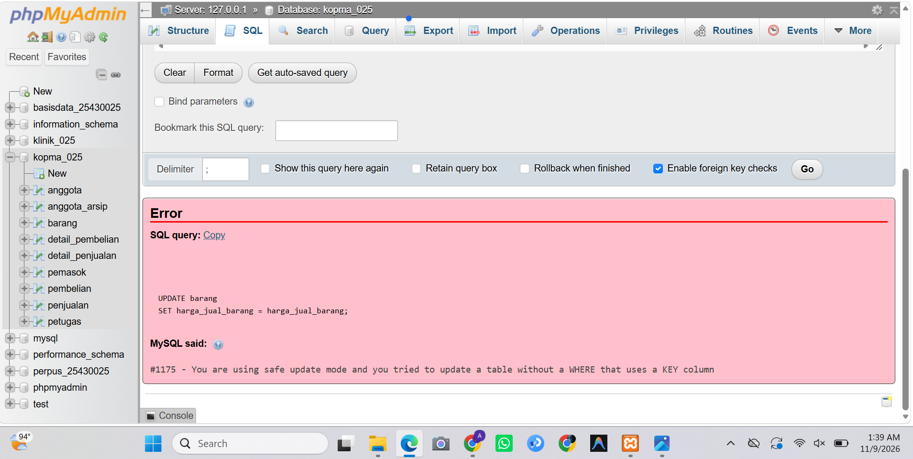

Untuk langkah 6, saya membuat nota uji PJ-UJI-001 (id_penjualan = 3) dengan satu detail. Detail itu ada sebelum nota dihapus.

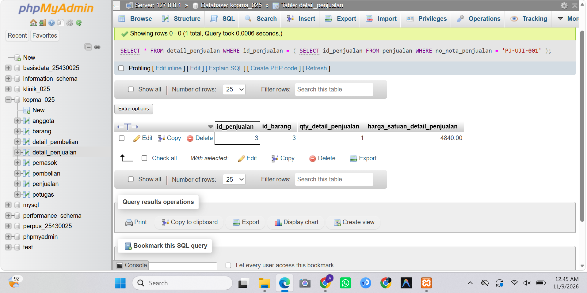

Setelah `DELETE FROM penjualan WHERE id_penjualan = 3`, pencarian detail nota itu mengembalikan nol baris, jadi detailnya ikut terhapus karena `ON DELETE CASCADE`.

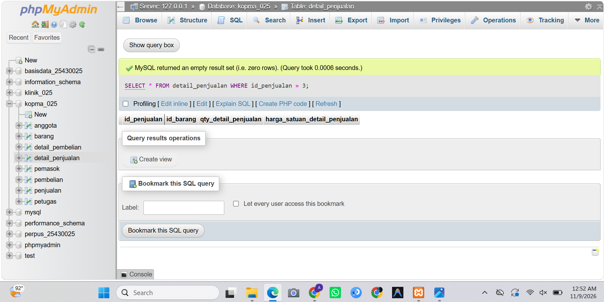

Menghapus petugas yang pernah melayani penjualan (`id_petugas = 3`) ditolak dengan ERROR 1451.

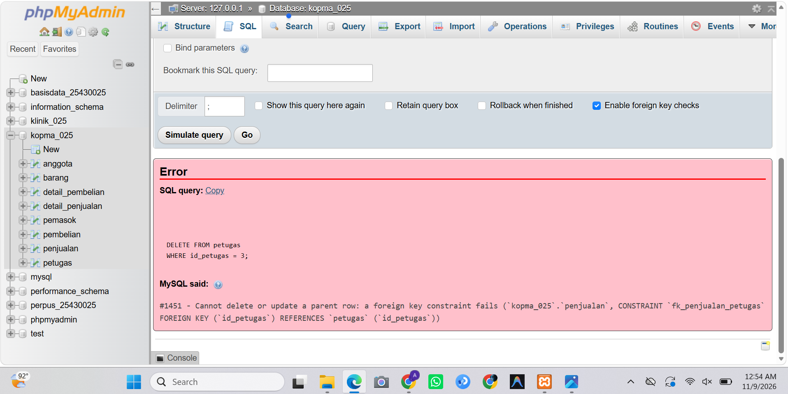

### 3.4 Skenario Uji (D.4)

Delapan skenario pengujian dijalankan untuk memastikan aturan database Kopma berjalan sesuai ketentuan. Hasil lengkap pengujian juga disimpan dalam berkas `p06_uji_kopma_25430025.md`.

#### A. Ringkasan Hasil Pengujian

| Kode | Masukan | Hasil yang Diharapkan | Hasil Nyata | Status | Aturan |
|---|---|---|---|---|---|
| UJ-01 | Nota PJ-UJI-101 dengan anggota aktif (ID 4) | Diterima | Diterima, ID penjualan 4 dan ID anggota 4 | LULUS | AB-02 |
| UJ-02 | Nota PJ-UJI-102 tanpa anggota | Diterima, anggota NULL | Diterima, ID penjualan 5 dan anggota NULL | LULUS | AB-02 |
| UJ-03 | Stok ATK-001 diubah menjadi -5 | Ditolak, ERROR 4025 | ERROR 4025, `ck_barang_stok` gagal | LULUS | AB-03 |
| UJ-04 | Nota dengan nomor PJ-2609-0142 yang sudah ada | Ditolak, ERROR 1062 | ERROR 1062, duplikasi `uq_penjualan_nota` | LULUS | AB-01 |
| UJ-05 | Detail dengan `qty_detail_penjualan = 0` | Ditolak, ERROR 4025 | ERROR 4025, `ck_detail_qty` gagal | LULUS | `ck_detail_qty` |
| UJ-06 | Anggota dengan NIM kembar | Ditolak, ERROR 1062 | ERROR 1062, duplikasi kolom NIM | LULUS | AB-05 |
| UJ-07 | Penjualan oleh petugas tidak dikenal (`id_petugas = 99`) | Ditolak, ERROR 1452 | ERROR 1452, `fk_penjualan_petugas` gagal | LULUS | `fk_penjualan_petugas` |
| UJ-08 | `UPDATE` tanpa `WHERE` pada mode aman | Ditolak, ERROR 1175 | ERROR 1175 | LULUS | Kebijakan lab |

#### B. Bukti Screenshot Pengujian

**1. UJ-01 — Nota dengan Anggota Aktif**

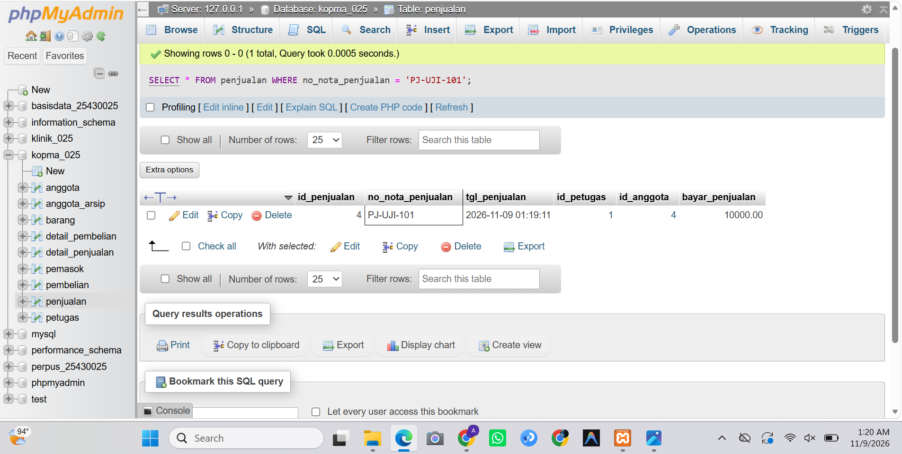

**2. UJ-02 — Nota Tanpa Anggota**

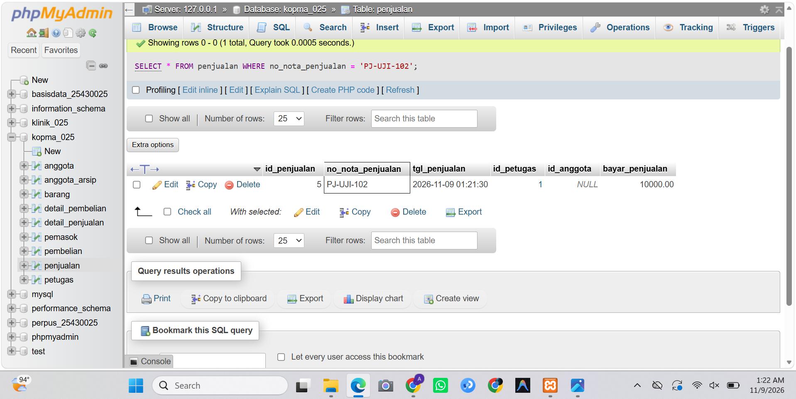

**3. UJ-03 — Pengujian Stok Negatif**

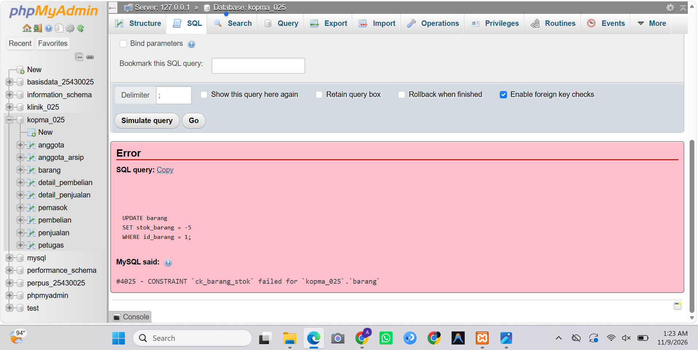

**4. UJ-04 — Pengujian Nomor Nota Duplikat**

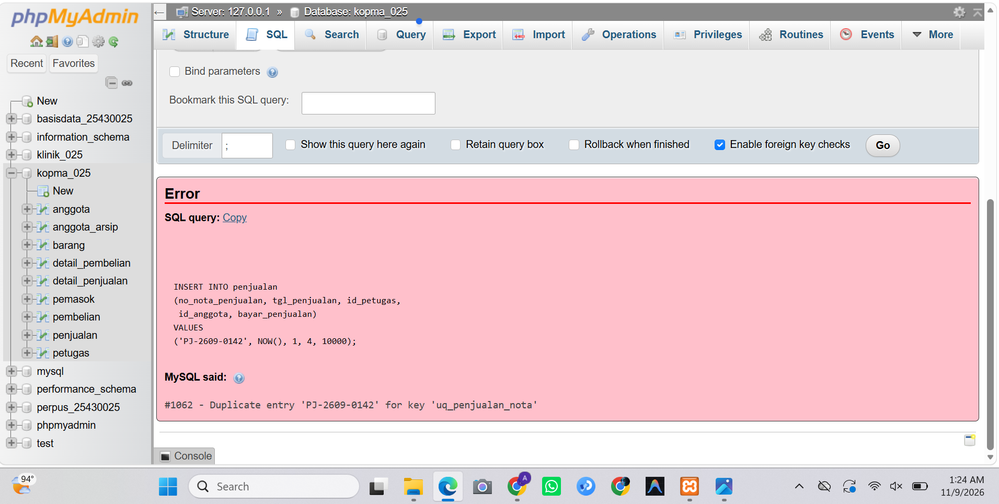

**5. UJ-05 — Pengujian Jumlah Barang Nol**

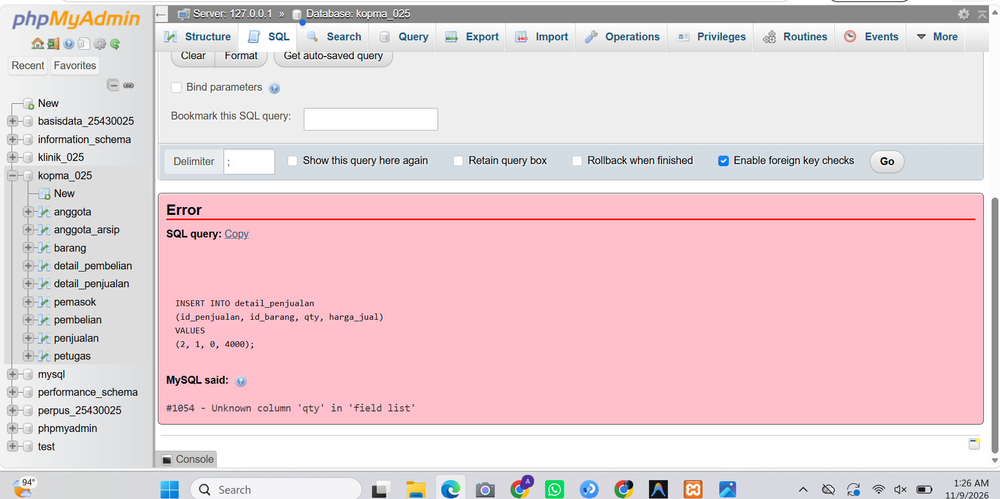

**6. UJ-06 — Pengujian NIM Duplikat**

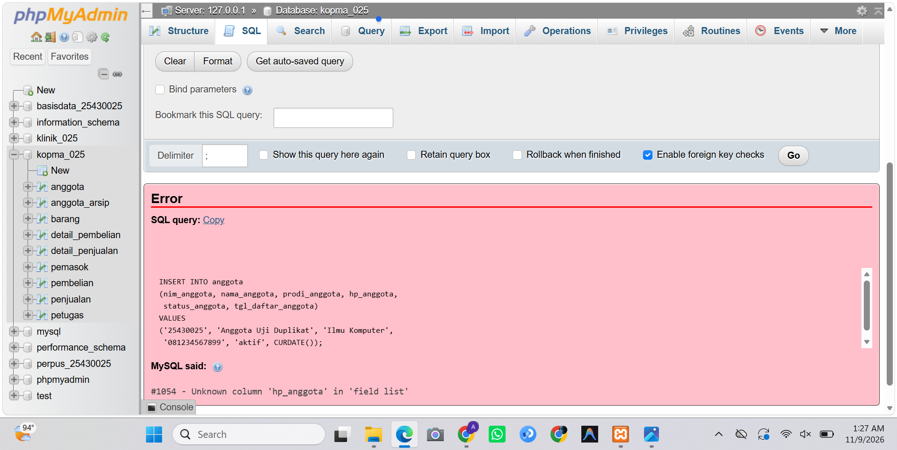

**7. UJ-07 — Pengujian Petugas Tidak Dikenal**

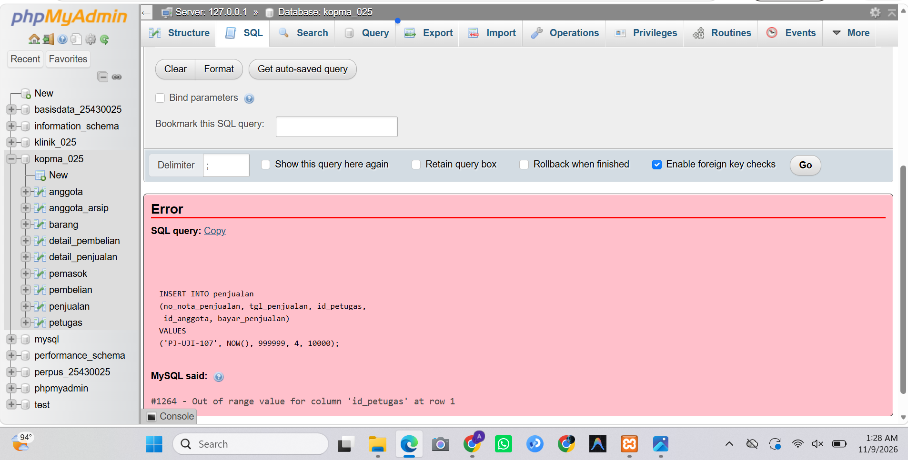

**8. UJ-08 — Pengujian SQL Safe Updates**


**Perbaikan UJ-03:** Pengujian stok negatif dilakukan kembali menggunakan kondisi `WHERE kode_barang = 'ATK-001'` agar barang yang diuji ditentukan berdasarkan kode barang, bukan nomor ID. Hasil pengujian menunjukkan ERROR 4025 karena constraint `ck_barang_stok` menolak nilai stok negatif. Dengan demikian, pengujian dinyatakan **LULUS**.

## 4. Jawaban Titik Analisis

**Titik Analisis 1.** `INSERT ... SELECT` mengambil harga langsung dari kolom `harga_jual_barang`, sehingga angkanya selalu sama dengan harga yang berlaku saat nota dibuat. Tidak ada risiko salah ketik, dan ini memenuhi AB-04 (harga satuan disalin dari harga jual saat itu). Nota PJ-2609-0142 **tidak ikut berubah** saat harga pulpen naik, karena harga itu disalin sebagai nilai ke `harga_satuan_detail_penjualan`, bukan dirujuk. Buktinya, nota itu tetap Rp4.000 per pulpen (lihat `p06_13`), sementara nota percobaan yang dibuat setelah harga naik menyimpan Rp4.840 (lihat `p06_20`). Dengan begitu riwayat penjualan tetap benar walaupun harga berubah.

**Titik Analisis 2.** Pada tabel `detail_penjualan`, kunci tamu `fk_detail_penjualan` dibuat dengan `ON DELETE CASCADE`, sehingga menghapus nota ikut menghapus detailnya. Detail memang tidak berarti tanpa notanya. Sebaliknya, kunci tamu `fk_penjualan_petugas` tidak memakai CASCADE, sehingga perilaku bawaannya menolak penghapusan baris induk yang masih dirujuk (ERROR 1451). Ini melindungi riwayat penjualan agar tidak kehilangan siapa yang melayani. Jika seorang kasir berhenti bekerja, barisnya tidak dihapus. Yang diubah adalah statusnya menjadi tidak aktif (perlu kolom status pada `petugas`, yang belum ada di rancangan saat ini), sehingga ia tidak lagi dipilih untuk nota baru tetapi nota lamanya tetap utuh.

**Titik Analisis 3.** Uji yang saya perkirakan GAGAL adalah menjual barang dengan qty melebihi stok (AB-03). `INSERT` ke `detail_penjualan` tetap diterima, karena aturan itu tidak dijaga saat baris detail dimasukkan. Constraint `CHECK` di tabel `barang` (`stok_barang >= 0`) hanya menilai nilai di barisnya sendiri dan tidak bisa membandingkan stok dengan qty di tabel lain. Server baru menolak ketika `UPDATE` pengurang stok dijalankan terpisah, yaitu setelah detail sudah tercatat. Tanpa transaksi, hasilnya nota dengan detail yang stoknya tidak terpotong. Masalah ini dicatat sebagai utang desain untuk Modul 14.

## 5. Hasil Latihan dan Modifikasi

### Latihan 1: mengarsipkan anggota nonaktif

Anggota nonaktif yang mendaftar sebelum 2025 dipindahkan ke `anggota_arsip` dengan `CREATE TABLE ... LIKE` dan `INSERT ... SELECT`.

```sql
CREATE TABLE anggota_arsip LIKE anggota;

INSERT INTO anggota_arsip
SELECT * FROM anggota
WHERE status_anggota = 'nonaktif' AND tgl_daftar_anggota < '2025-01-01';
```

Sebelum menghapus, saya memeriksa apakah anggota itu masih punya penjualan. Andi Saputra (A003) memiliki 0 transaksi.

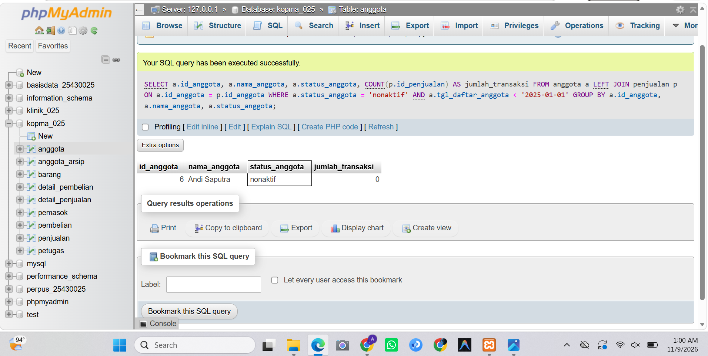

Penghapusan memakai pengaman agar anggota yang masih punya penjualan tidak ikut terhapus. Syarat `IS NOT NULL` pada subquery sengaja dipasang karena `NOT IN` tidak akan mengembalikan baris apa pun bila subquery menghasilkan NULL (nota tanpa anggota).

```sql
DELETE FROM anggota
WHERE status_anggota = 'nonaktif' AND tgl_daftar_anggota < '2025-01-01'
  AND id_anggota NOT IN (SELECT id_anggota FROM penjualan WHERE id_anggota IS NOT NULL);
```

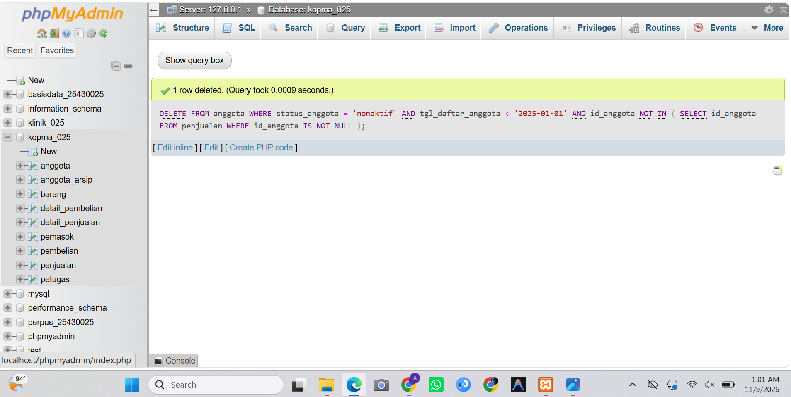

Verifikasi: `anggota_arsip` berisi 1 baris (A003 Andi Saputra).

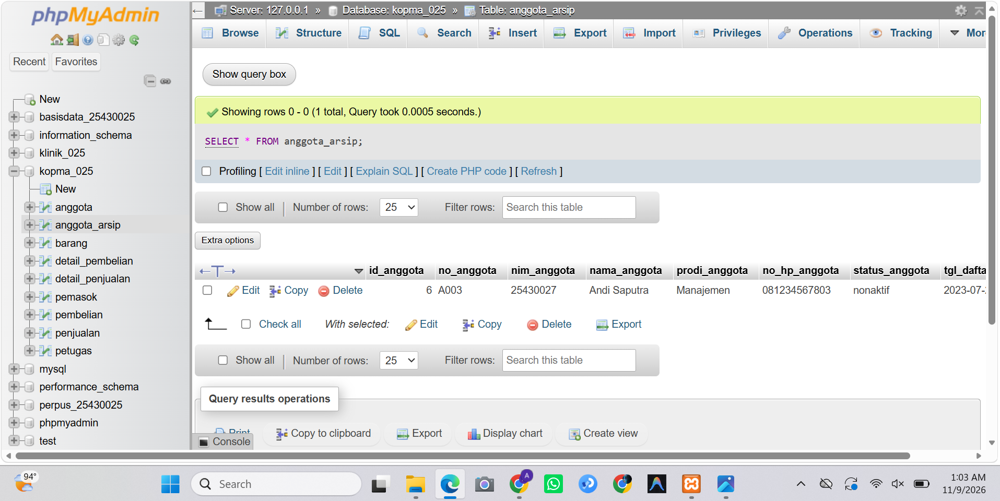

### Latihan 2: Menaikkan Harga Makanan 5%

Perintah berikut digunakan untuk menaikkan harga barang dengan kategori makanan sebesar 5%. Mode `SQL_SAFE_UPDATES` tetap diaktifkan dan kondisi `id_barang > 0` ditambahkan agar sesuai dengan aturan praktikum.

```sql
SET SESSION sql_safe_updates = 1;

UPDATE barang
SET harga_jual_barang = ROUND((harga_jual_barang * 1.05) / 100) * 100
WHERE kategori_barang = 'makanan'
AND id_barang > 0;
```

Harga Roti Cokelat sebelum update:

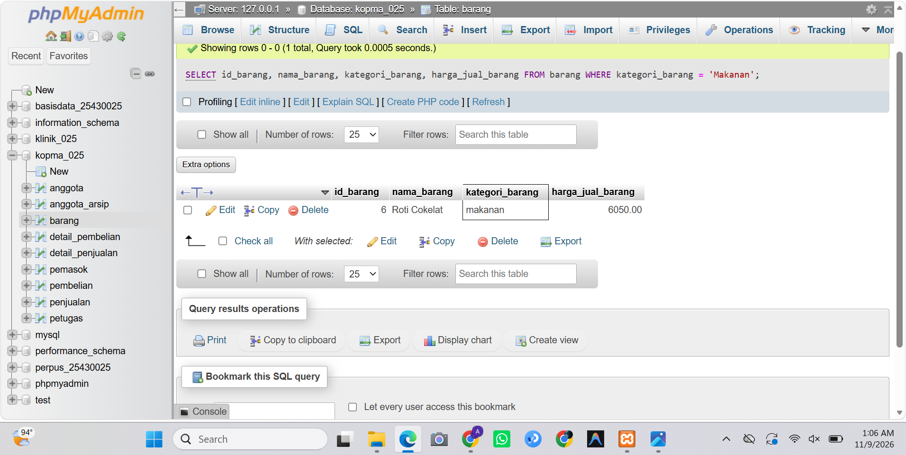

Hasil perintah update menunjukkan 1 baris terpengaruh:

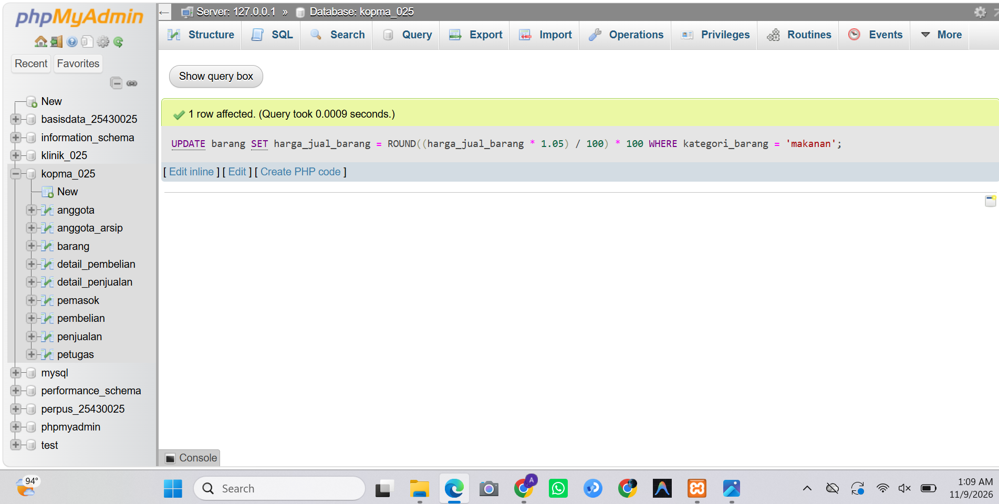

Setelah update, harga Roti Cokelat diperiksa kembali melalui menu Browse pada tabel `barang`.

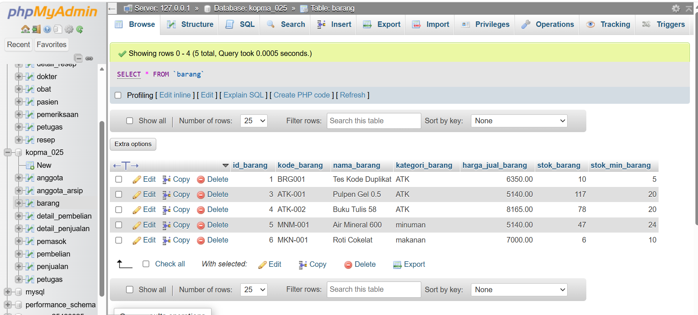

## 6. Tugas Mandiri: Milestone Proyek 6

Proyek: **Klinik Mutiara** (`klinik_025`), dengan 7 tabel sesuai ERD Modul 3: `pasien`, `dokter`, `petugas`, `obat`, `pemeriksaan`, `resep`, `detail_resep`.

**Berkas:** `p06_data_25430025.sql` dan `p06_uji_25430025.md` (ada di repositori).

**Parameter P.** P = (2 digit terakhir NIM mod 9) + 1 = (25 mod 9) + 1 = 7 + 1 = **8**. Syarat tabel transaksi utama: minimal 10 × P = **80 baris** yang tersebar pada minimal tiga tanggal berbeda.

### 6.1 Jumlah Data

| Tabel | Jumlah baris |
|---|---:|
| pasien | 5 |
| dokter | 5 |
| petugas | 5 |
| obat | 5 |
| pemeriksaan | 80 |
| resep | 15 |
| detail_resep | 15 |

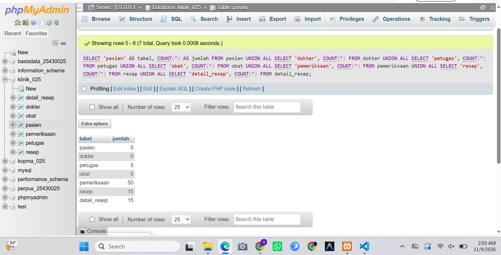

Data pemeriksaan tersebar pada tiga tanggal, yaitu 1 Oktober 2026 sebanyak 25 baris, 2 Oktober 2026 sebanyak 25 baris, dan 3 Oktober 2026 sebanyak 30 baris. Dengan demikian, total data pemeriksaan adalah 80 baris dan sudah memenuhi ketentuan 10 × P = 10 × 8.

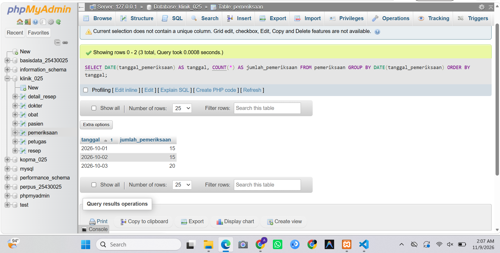

### 6.2 Skenario uji

Total 10 skenario: 4 positif, 5 negatif, dan 1 uji yang gagal.

| Kode | Jenis | Masukan | Harapan | Hasil nyata | Status | Aturan / constraint |
|---|---|---|---|---|---|---|
| UJP-01 | Positif | Hitung baris tabel induk | Masing-masing minimal 5 baris | pasien, dokter, petugas, obat masing-masing 5 baris | LULUS | AB-xx [LENGKAPI] |
| UJP-02 | Positif | Sebaran tanggal pemeriksaan | Minimal 3 tanggal berbeda | 3 tanggal (01, 02, 03 Okt 2026) | LULUS | AB-xx [LENGKAPI] |
| UJP-03 | Positif | `JOIN` pemeriksaan, pasien, dokter | 10 baris dengan nama pasien dan dokter | 10 baris tampil lengkap | LULUS | fk_pemeriksaan_pasien, fk_pemeriksaan_dokter |
| UJP-04 | Positif | `JOIN` resep, detail resep, obat | 15 resep dengan nama obat | 15 baris tampil lengkap | LULUS | fk_detail_resep_obat |
| UJN-01 | Negatif | Pemeriksaan dengan dokter `DR-999` | Ditolak, ERROR 1452 | ERROR 1452 | LULUS | fk_pemeriksaan_dokter |
| UJN-02 | Negatif | Detail resep dengan obat `OB-999` | Ditolak, ERROR 1452 | ERROR 1452 | LULUS | fk_detail_resep_obat |
| UJN-03 | Negatif | Pemeriksaan dengan pasien `PS-999` | Ditolak, ERROR 1452 | ERROR 1452 | LULUS | fk_pemeriksaan_pasien |
| UJN-04 | Negatif | `jumlah_obat` diubah menjadi 0 | Ditolak, ERROR 4025 | ERROR 4025 | LULUS | ck_detail_resep_jumlah |
| UJN-05 | Negatif | Stok obat diubah menjadi -5 | Ditolak, ERROR 4025 | ERROR 4025 | LULUS | ck_obat_stok |
| UG-01 | Uji gagal | Dua pasien dengan `no_identitas` yang sama | Ditolak, ERROR 1062 | Diterima (tidak ada galat) | **GAGAL** | `no_identitas` belum UNIQUE |

Bukti uji positif:

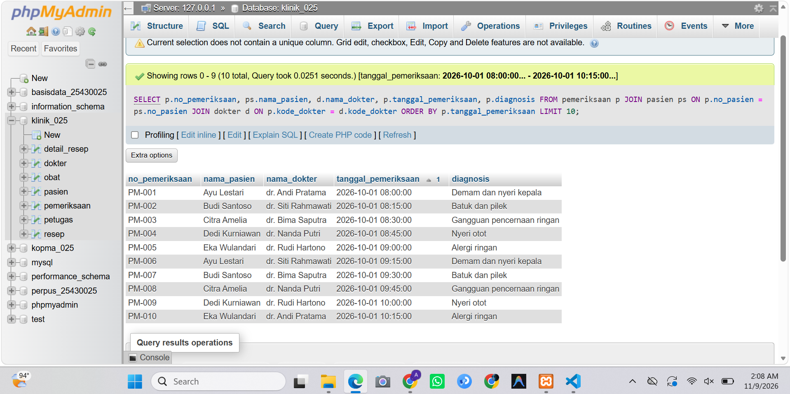

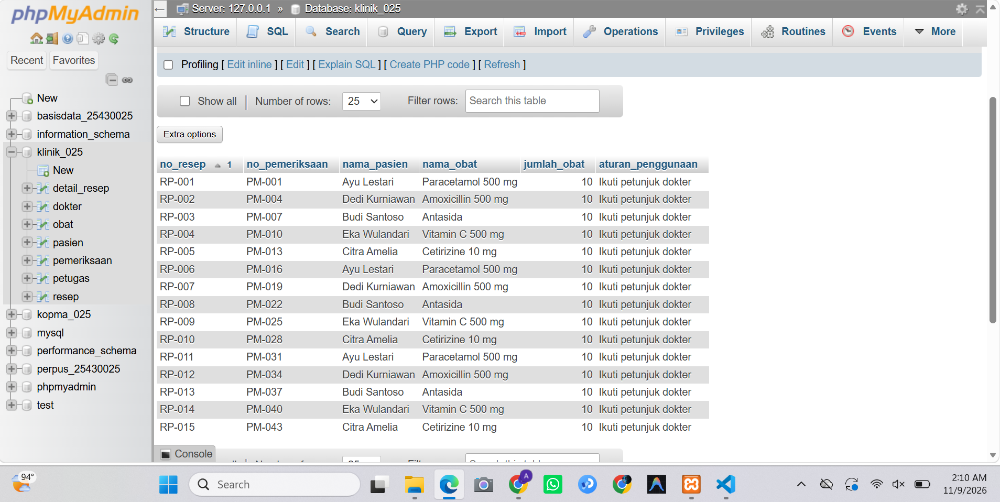

Bukti uji negatif:

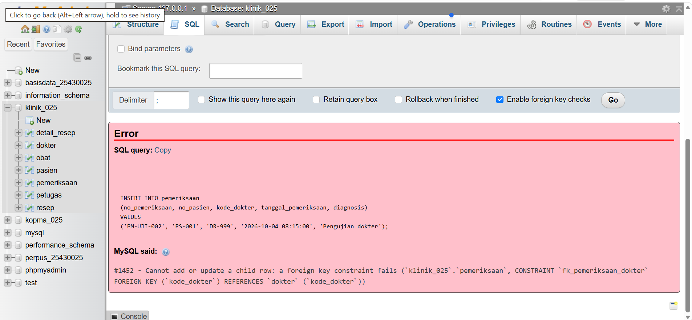

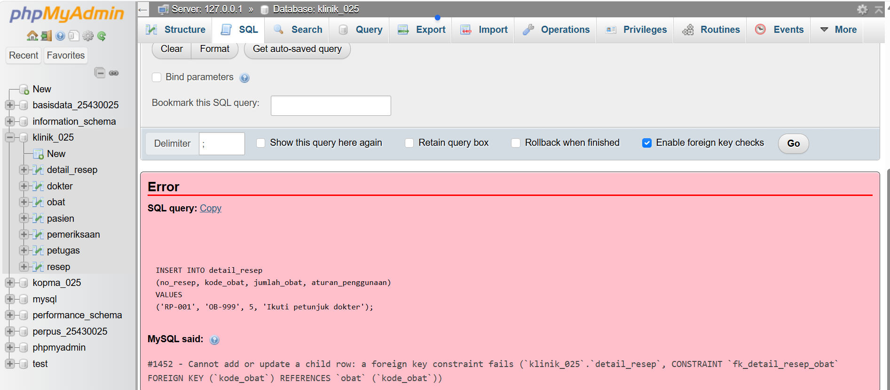

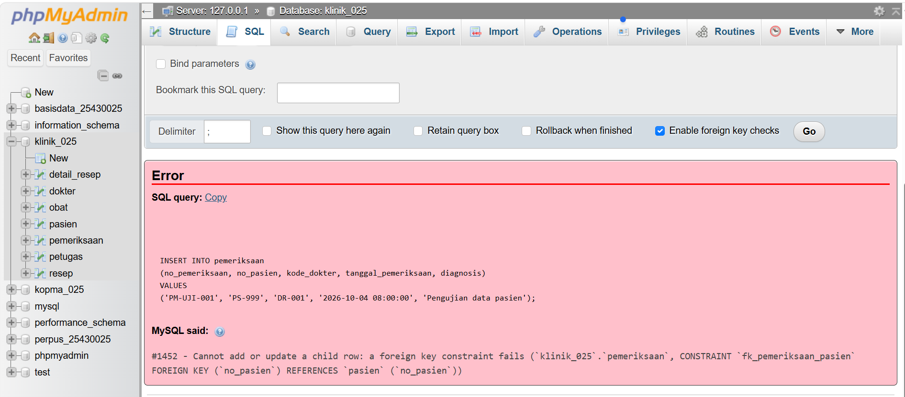

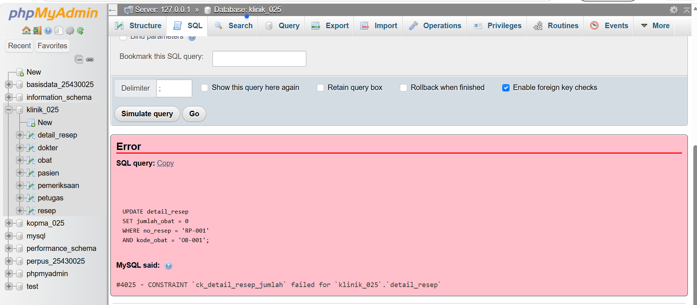

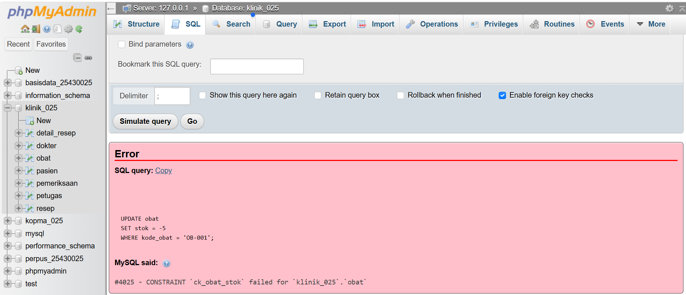

Bukti uji gagal:

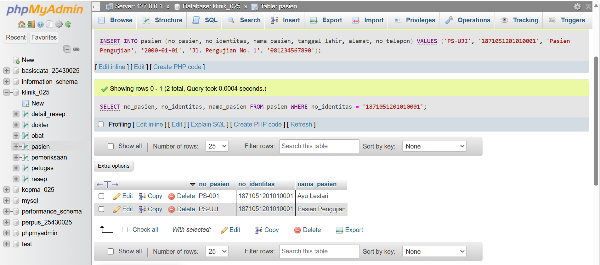

### 6.3 Utang Desain untuk Modul 14

- **UG-01.** NIK `1871051201010001` diterima untuk dua pasien (PS-001 dan PS-UJI) karena kolom `no_identitas` belum menggunakan constraint `UNIQUE`. Perbaikan yang direncanakan adalah menambahkan constraint `UNIQUE` pada DDL, kemudian mengulangi pengujian sampai data duplikat ditolak dengan ERROR 1062. Baris pengujian PS-UJI dihapus agar data sampel tetap bersih.

- **UG-02.** Sistem belum memiliki validasi yang memastikan `jumlah_obat` pada `detail_resep` tidak melebihi stok obat pada tabel `obat`. Constraint `CHECK` biasa tidak dapat membandingkan nilai dari dua tabel berbeda. Oleh karena itu, validasi ini perlu ditangani menggunakan transaksi atau pemeriksaan tambahan pada proses penyimpanan resep di Modul 14.

### 6.4 Keputusan Desain

- Nama kolom pada data sampel mengikuti ERD Modul 3 dan hasil normalisasi Modul 4.
- Data induk seperti pasien, dokter, petugas, dan obat dimasukkan terlebih dahulu sebelum data transaksi agar relasi kunci tamu dapat berjalan dengan benar.
- Skrip DDL dan skrip data diuji dari basis data kosong untuk memastikan proses pembuatan tabel dan pengisian data berjalan sesuai urutan.
- Data sampel Klinik Mutiara menggunakan beberapa pasien, dokter, dan obat yang berbeda. Data resep juga dibuat dalam beberapa transaksi agar pengujian relasi antara pemeriksaan, resep, detail resep, dan obat dapat dilakukan.
  
## 7. Pembahasan dan Kendala

| Galat / kendala | Penyebab | Cara mengatasi |
|---|---|---|
| ERROR 1452 saat mengisi `detail_penjualan` dengan `id_penjualan = 1` | ID nota tidak ditemukan pada tabel `penjualan`. Nota PJ-2609-0142 memiliki ID 2 karena `AUTO_INCREMENT`. | Menggunakan ID yang benar, yaitu 2. |
| Harga barang naik dua kali | Perintah kenaikan harga 10% dijalankan dua kali sehingga harga barang berubah dari nilai awal. | Membangun ulang database dan menjalankan skrip data satu kali agar harga kembali sesuai data awal. |
| ERROR 1054 pada uji UJ-05 dan UJ-06 | Nama kolom yang digunakan dalam perintah pengujian tidak sesuai dengan struktur tabel. | Memeriksa nama kolom menggunakan `DESCRIBE tabel`, kemudian memperbaiki perintah pengujian. |
| ERROR 1264 pada uji UJ-07 | Nilai `id_petugas` berada di luar rentang tipe data kolom. | Menggunakan ID yang masih dalam rentang tipe data tetapi belum terdaftar pada tabel `petugas`, misalnya 99. |
| ERROR 1175 pada uji UJ-08 | Mode `SQL_SAFE_UPDATES` menolak perintah UPDATE tanpa kondisi yang sesuai. | Menambahkan kondisi pada kolom kunci agar perintah memenuhi aturan safe update. |
| ERROR 1451 saat menghapus petugas | Data petugas masih digunakan sebagai referensi pada tabel `penjualan`. | Tidak menghapus petugas yang masih digunakan oleh transaksi. |

**Pelajaran yang diperoleh:**

Selama praktikum, saya memahami bahwa galat yang muncul belum tentu merupakan galat yang sedang diuji. Kesalahan nama kolom dan nilai ID dapat menyebabkan munculnya galat lain. Oleh karena itu, saya perlu memeriksa struktur tabel dan membaca pesan galat sebelum menentukan hasil pengujian.

## 8. Kesimpulan

Pertemuan ini menunjukkan bahwa constraint (`CHECK`, `UNIQUE`, kunci tamu) dan mode aman benar-benar bekerja melindungi data, tetapi hanya untuk aturan yang sudah dijaga server. Aturan yang melibatkan beberapa tabel, seperti qty yang melebihi stok, atau yang belum diberi constraint, seperti NIK pasien ganda, lolos dan harus dicatat sebagai utang desain. Skenario uji tertulis dan skrip yang dapat dijalankan ulang membuat hasil kerja bisa diperiksa orang lain.

## 9. Pernyataan Penggunaan AI

Saya menggunakan Claude (Anthropic) sebagai alat bantu untuk: merangkum isi Modul 6 dari buku praktikum, memeriksa tangkapan layar dan menunjukkan galat yang tidak sesuai harapan (misalnya ERROR 1054 dan 1264), menyarankan perintah SQL untuk mengulang uji, serta membantu menyusun kerangka laporan. Perintah SQL dijalankan dan hasilnya diambil sendiri di phpMyAdmin.

## 10. Bukti Git

- Repositori: [LENGKAPI: tautan repositori `basisdata-25430025`]
- Berkas yang di-commit: `laporan/p06_laporan_25430025.md`, `laporan/img/`, `p06_data_kopma_25430025.sql`, `p06_uji_kopma_25430025.md`, `p06_data_25430025.sql`, `p06_uji_25430025.md`

---

