# Laporan Praktikum Basis Data - Pertemuan 7

**Nama:** Mutiara Icha Yani
**Npm:** 25430025
**Kelas:** A
**Tanggal:** 9 November 2026

---

## 1. Tujuan Praktikum

1. Memilih kolom tertentu (proyeksi) dan memberi alias pada kolom hasil.
2. Menyaring baris dengan `WHERE` memakai operator perbandingan, `AND`, `OR`, `IN`, `BETWEEN`, `LIKE`, dan `IS NULL`.
3. Mengurutkan dan membatasi hasil dengan `ORDER BY` dan `LIMIT`.
4. Memakai fungsi per baris (`CONCAT`, `UPPER`, `FORMAT`, `DATE_FORMAT`, `DATEDIFF`, `IFNULL`, `CASE`) untuk menghitung dan memformat data.
5. Menerapkan materi tersebut pada studi kasus Kopma (`kopma_025`) dan proyek mandiri Klinik Mutiara (`klinik_025`).

## 2. Ringkasan Dasar Teori

- **Proyeksi** adalah pemilihan kolom pada `SELECT`. Kolom turunan (hasil perhitungan) dapat diberi nama baru dengan alias (`AS`).
- **Penyaringan** memakai `WHERE` untuk memilih baris yang memenuhi syarat. `IN` mewakili beberapa kondisi `OR` pada satu kolom, `BETWEEN` memeriksa rentang inklusif, `LIKE` mencocokkan pola teks (`%` mewakili sembarang karakter), dan `IS NULL` menguji nilai kosong.
- **NULL** berarti nilai tidak diketahui. Perbandingan dengan NULL bernilai UNKNOWN, sehingga `= NULL` tidak pernah menghasilkan baris. Pengujian harus memakai `IS NULL` atau `IS NOT NULL`.
- **Urutan pemrosesan** kueri adalah `FROM`, `WHERE`, `SELECT`, lalu `ORDER BY`. Karena itu alias dari `SELECT` belum dikenal di `WHERE`, tetapi sudah dikenal di `ORDER BY`.
- **Prioritas operator:** `AND` diproses lebih dulu daripada `OR`. Tanda kurung dipakai untuk mengatur urutan evaluasi.
- **Fungsi per baris** menghasilkan satu nilai untuk setiap baris, berbeda dengan fungsi agregat (`SUM`, `COUNT`) yang merangkum banyak baris menjadi satu nilai.

## 3. Hasil Langkah Percobaan

Basis data: `kopma_025`. Berkas kueri: `p07_kueri_kopma_25430025.sql`.

### 3.1 Proyeksi dan Penyaringan

**KI-03: Barang yang perlu dipesan ulang**

```sql
SELECT
    kode_barang, nama_barang, stok_barang, stok_min_barang,
    stok_min_barang - stok_barang AS kurang
FROM barang
WHERE stok_barang < stok_min_barang
ORDER BY kurang DESC;
```


Keterangan: `WHERE` menyaring barang yang stoknya di bawah stok minimum. Kolom `kurang` adalah selisih keduanya, dan `ORDER BY kurang DESC` menaruh barang dengan kekurangan terbesar di paling atas.

**KI-04: Barang kategori ATK atau minuman**

```sql
SELECT kode_barang, nama_barang, kategori_barang, harga_jual_barang
FROM barang
WHERE kategori_barang IN ('ATK', 'minuman')
ORDER BY kategori_barang, nama_barang;
```

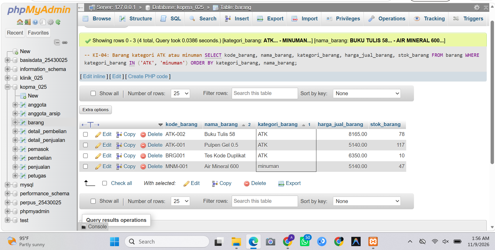

Keterangan: `IN` adalah penulisan ringkas dari dua kondisi `OR`. Hasil diurutkan menurut kategori, lalu nama barang.

**KI-05: Nota penjualan pada September 2026**

```sql
SELECT no_nota_penjualan, tgl_penjualan, id_anggota, bayar_penjualan
FROM penjualan
WHERE tgl_penjualan BETWEEN '2026-09-01' AND '2026-09-30'
ORDER BY tgl_penjualan;
```

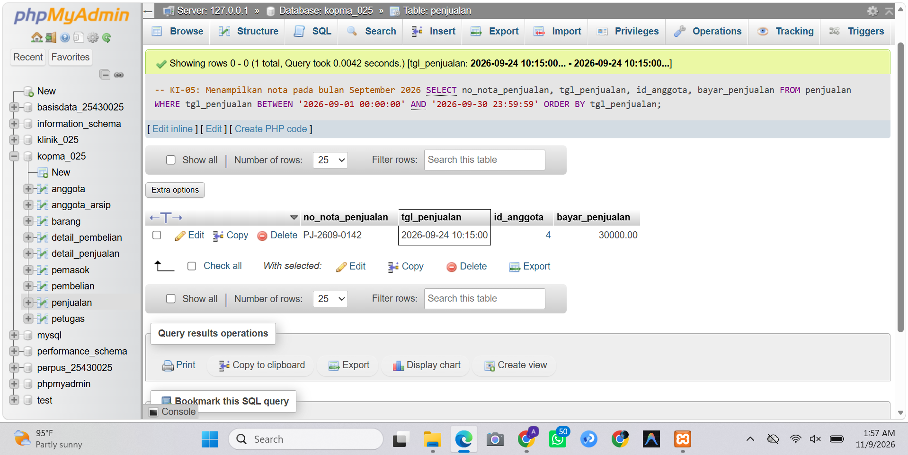

Keterangan: `BETWEEN` bersifat inklusif. Jika `tgl_penjualan` bertipe DATETIME, nota tanggal 30 September setelah pukul 00:00 tidak tampil, sehingga perlu `DATE(tgl_penjualan)` atau batas atas `< '2026-10-01'`.

**KI-06: Anggota yang belum memiliki nomor HP**

```sql
SELECT no_anggota, nama_anggota, no_hp_anggota
FROM anggota
WHERE no_hp_anggota IS NULL
ORDER BY nama_anggota;
```

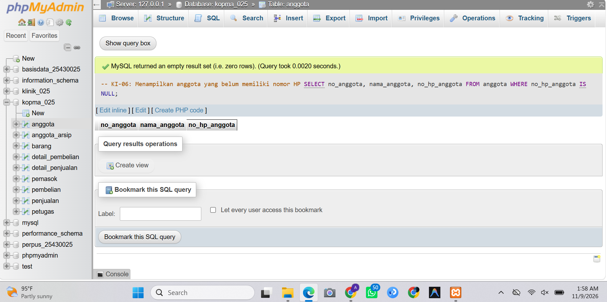

Keterangan: nomor HP yang kosong diuji dengan `IS NULL`.

### 3.2 Pola Teks dan Nilai Kosong

**KI-07: Anggota dengan nama mengandung huruf a**

```sql
SELECT
    CONCAT(nama_anggota, ' (', no_anggota, ')') AS anggota,
    DATE_FORMAT(tgl_daftar_anggota, '%d-%m-%Y') AS tanggal_daftar,
    IFNULL(no_hp_anggota, '-') AS hp,
    CASE
        WHEN status_anggota = 'aktif' THEN 'Diskon 5%'
        ELSE 'Tanpa diskon'
    END AS keterangan
FROM anggota
WHERE nama_anggota LIKE '%a%'
ORDER BY tgl_daftar_anggota DESC
LIMIT 5;
```

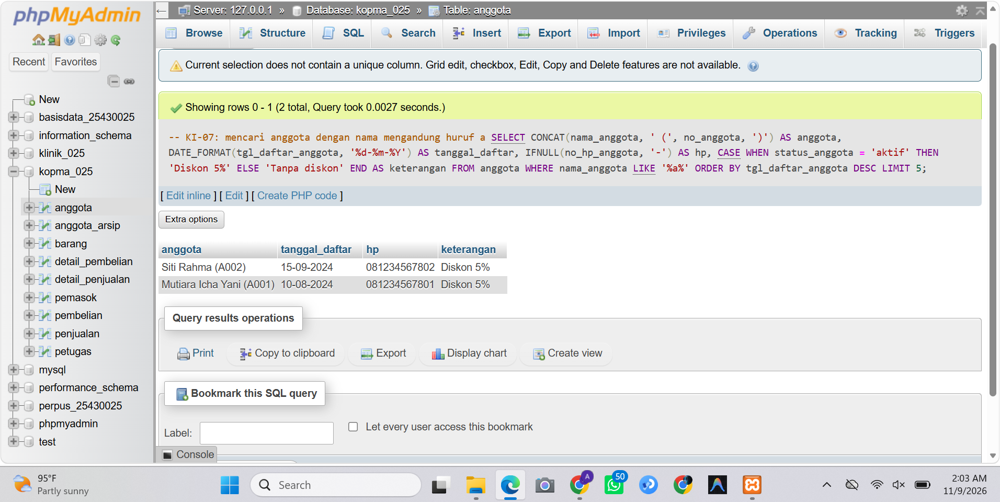

Keterangan: `LIKE '%a%'` mencari nama yang memuat huruf a. `CONCAT` menggabungkan nama dan nomor anggota, `DATE_FORMAT` mengubah format tanggal, `IFNULL` mengganti NULL dengan tanda `-`, dan `CASE` memberi keterangan diskon. `ORDER BY ... DESC LIMIT 5` mengambil 5 anggota yang paling baru mendaftar. Pengurutan memakai kolom asli `tgl_daftar_anggota`, bukan hasil `DATE_FORMAT`, agar urutan tanggal benar.

### 3.3 Tanggal dan Perhitungan per Baris

**KI-08: Lama keanggotaan dalam hari**

```sql
SELECT
    no_anggota, nama_anggota, tgl_daftar_anggota,
    DATEDIFF(CURDATE(), tgl_daftar_anggota) AS lama_hari,
    CASE
        WHEN DATEDIFF(CURDATE(), tgl_daftar_anggota) < 180 THEN 'Baru'
        ELSE 'Lama'
    END AS kategori_keanggotaan
FROM anggota
ORDER BY lama_hari DESC;
```

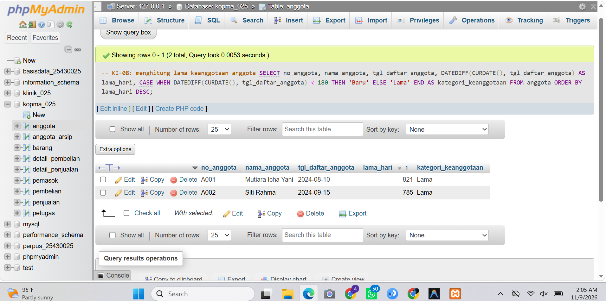

Keterangan: `DATEDIFF` menghitung selisih hari dari tanggal daftar sampai hari ini. Kurang dari 180 hari dikategorikan *Baru*, selebihnya *Lama*. Hasil berubah setiap hari karena memakai `CURDATE()`.

**KI-09: Subtotal setiap barang pada nota PJ-2609-0142**

```sql
SELECT
    p.no_nota_penjualan, b.nama_barang,
    dp.qty_detail_penjualan, dp.harga_satuan_detail_penjualan,
    dp.qty_detail_penjualan * dp.harga_satuan_detail_penjualan AS subtotal
FROM penjualan p
JOIN detail_penjualan dp ON p.id_penjualan = dp.id_penjualan
JOIN barang b ON dp.id_barang = b.id_barang
WHERE p.no_nota_penjualan = 'PJ-2609-0142';
```

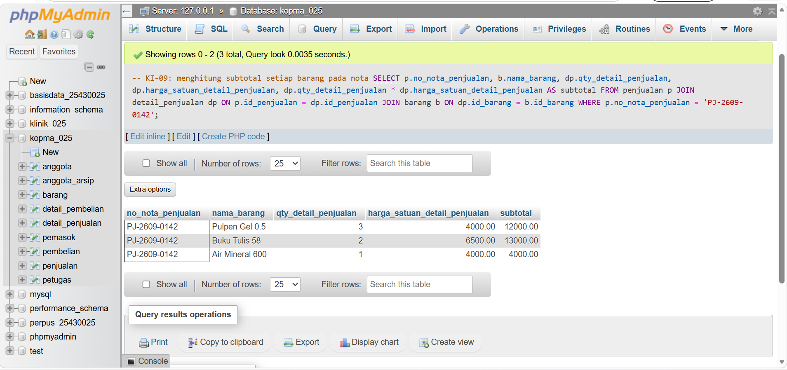

Keterangan: nama barang ada di tabel `barang`, sedangkan kuantitas dan harga ada di `detail_penjualan`, sehingga digabung dengan `JOIN`. Subtotal dihitung per baris.

## 4. Jawaban Titik Analisis

### Titik Analisis 1: Penggunaan alias pada WHERE

Kueri uji yang sengaja salah:

```sql
SELECT kode_barang, nama_barang, stok_barang, stok_min_barang,
       stok_min_barang - stok_barang AS kurang
FROM barang
WHERE kurang > 0;
```

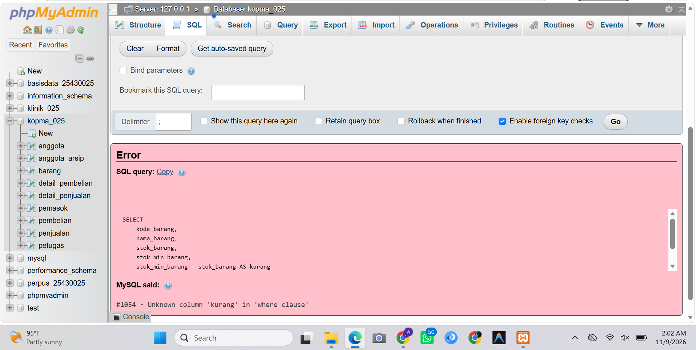

Jawaban: kueri menghasilkan galat *Unknown column 'kurang' in 'where clause'*. Urutan pemrosesan adalah `FROM`, `WHERE`, `SELECT`, lalu `ORDER BY`. Saat `WHERE` dijalankan, alias `kurang` belum dibuat karena baru didefinisikan pada tahap `SELECT`.

Perbaikan: perhitungan ditulis ulang di `WHERE`.

```sql
SELECT kode_barang, nama_barang, stok_barang, stok_min_barang,
       stok_min_barang - stok_barang AS kurang
FROM barang
WHERE stok_min_barang - stok_barang > 0
ORDER BY kurang DESC;
```

Alias tetap bisa dipakai di `ORDER BY` karena tahap itu berjalan setelah `SELECT`.

### Titik Analisis 2: Mencari nilai NULL

```sql
SELECT no_anggota, nama_anggota, no_hp_anggota
FROM anggota
WHERE no_hp_anggota IS NULL;
```

Jawaban: cara yang benar adalah `IS NULL`. Penulisan `= NULL` tidak menghasilkan baris apa pun karena perbandingan dengan NULL bernilai UNKNOWN, bukan TRUE. Kebalikannya memakai `IS NOT NULL`.

### Titik Analisis 3: Perhitungan per baris dan fungsi agregat

```sql
SELECT
    p.no_nota_penjualan,
    SUM(dp.qty_detail_penjualan * dp.harga_satuan_detail_penjualan) AS total_nota
FROM penjualan p
JOIN detail_penjualan dp ON p.id_penjualan = dp.id_penjualan
WHERE p.no_nota_penjualan = 'PJ-2609-0142'
GROUP BY p.no_nota_penjualan;
```

Jawaban: perhitungan per baris (KI-09) menghasilkan satu subtotal untuk setiap barang, sedangkan fungsi agregat `SUM` merangkum semua baris nota menjadi satu nilai total. Total ini sama dengan jumlah seluruh subtotal pada KI-09.

## 5. Hasil Latihan dan Modifikasi

### Latihan 1: Nama barang huruf kapital dan harga format Rupiah

```sql
SELECT
    UPPER(nama_barang) AS nama_barang,
    CONCAT('Rp', FORMAT(harga_jual_barang, 0, 'id_ID')) AS harga
FROM barang;
```

Keterangan: `UPPER` mengubah nama menjadi huruf kapital. `FORMAT` dengan locale `id_ID` memberi pemisah ribuan gaya Indonesia, lalu `CONCAT` menambahkan awalan `Rp`.

### Latihan 2A: Kueri yang berjalan tetapi logikanya keliru

Tujuan: barang kategori ATK atau minuman yang harganya di atas 5000.

```sql
SELECT kode_barang, nama_barang, kategori_barang, harga_jual_barang
FROM barang
WHERE kategori_barang = 'ATK'
   OR kategori_barang = 'minuman'
   AND harga_jual_barang > 5000;
```

Keterangan: `AND` diproses lebih dulu daripada `OR`, sehingga kondisi terbaca *ATK* **atau** (*minuman* dan harga > 5000). Semua barang ATK tetap tampil walaupun harganya 5000 atau kurang.

### Latihan 2B: Perbaikan dengan tanda kurung

```sql
SELECT kode_barang, nama_barang, kategori_barang, harga_jual_barang
FROM barang
WHERE (kategori_barang = 'ATK'
       OR kategori_barang = 'minuman')
  AND harga_jual_barang > 5000;
```

Keterangan: tanda kurung memaksa `OR` dievaluasi lebih dulu, sehingga syarat harga di atas 5000 berlaku untuk kedua kategori. Jumlah baris hasil 2B lebih sedikit atau sama dengan 2A.

## 6. Tugas Mandiri: Milestone Proyek 7

Proyek: Klinik Mutiara. Basis data: `klinik_025`. Berkas kueri: `p07_kueri_25430025.sql`.

### 6.1 Kebutuhan Informasi

**KI-01: Jumlah pasien yang berobat setiap hari**

```sql
SELECT
    DATE(tanggal_pemeriksaan) AS tanggal,
    COUNT(DISTINCT no_pasien) AS jumlah_pasien
FROM pemeriksaan
GROUP BY DATE(tanggal_pemeriksaan)
ORDER BY tanggal;
```

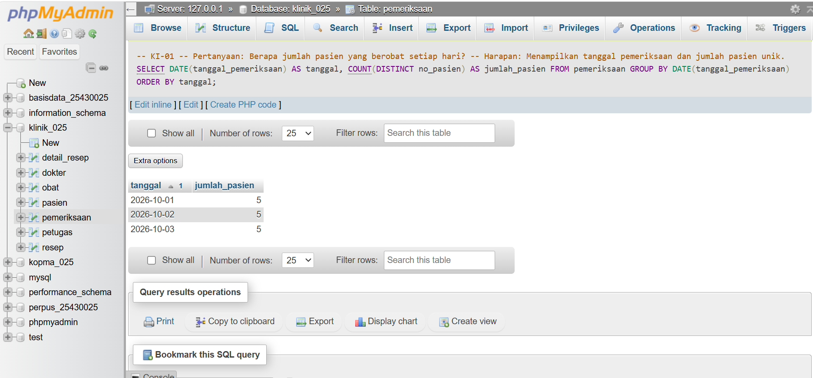

Keterangan: `DATE()` membuang bagian jam agar pemeriksaan pada hari yang sama dikelompokkan. `COUNT(DISTINCT no_pasien)` menghitung pasien unik per hari.

**KI-02: Riwayat pemeriksaan pasien**

```sql
SELECT no_pemeriksaan, no_pasien, kode_dokter, tanggal_pemeriksaan, diagnosis
FROM pemeriksaan
ORDER BY tanggal_pemeriksaan DESC;
```

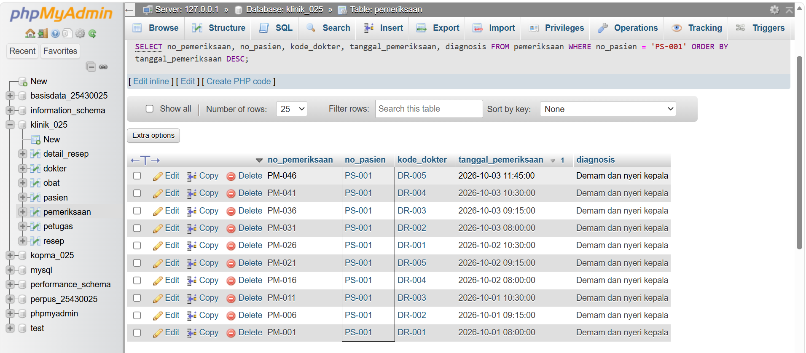

Keterangan: menampilkan seluruh riwayat dari yang terbaru. Untuk satu pasien, tambahkan `WHERE no_pasien = 'PS-001'` (disesuaikan). Nama pasien dan dokter memerlukan `JOIN` dengan tabel `pasien` dan `dokter`.

**KI-03: Obat yang diberikan kepada pasien**
-- Pertanyaan: Obat apa saja yang diberikan kepada pasien?
-- Harapan: Menampilkan informasi pasien, resep, nama obat,
-- jumlah obat, dan aturan pakai.

SELECT
    pasien.no_pasien,
    pasien.nama_pasien,
    resep.no_resep,
    obat.nama_obat,
    detail_resep.jumlah,
    detail_resep.aturan_pakai
FROM resep
JOIN pasien
    ON resep.no_pasien = pasien.no_pasien
JOIN detail_resep
    ON resep.no_resep = detail_resep.no_resep
JOIN obat
    ON detail_resep.kode_obat = obat.kode_obat;

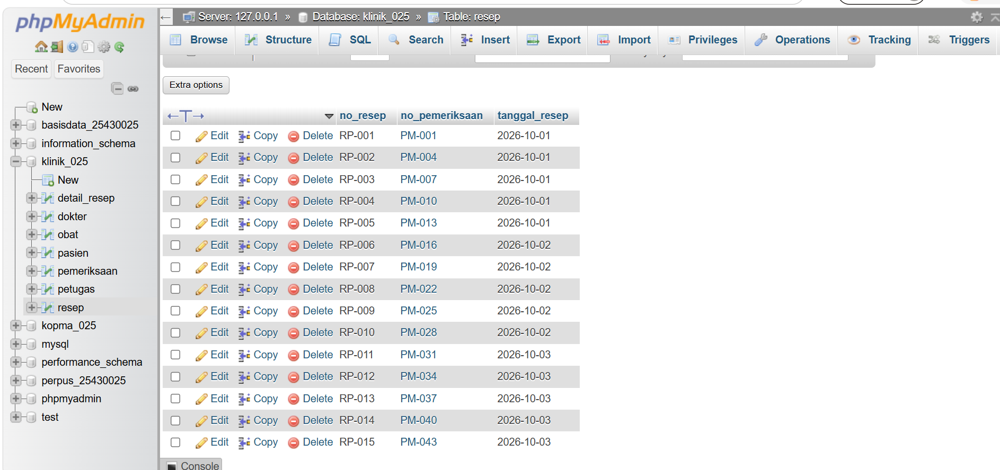

Keterangan: informasi nama obat dalam resep tersebar di tabel `resep`, `detail_resep`, dan `obat`, sehingga memerlukan `JOIN` ketiganya.

**KI-04: Obat dengan stok mencapai batas minimum**

```sql
SELECT kode_obat, nama_obat, stok, satuan, batas_minimum_stok
FROM obat
WHERE stok <= batas_minimum_stok
ORDER BY stok ASC;
```

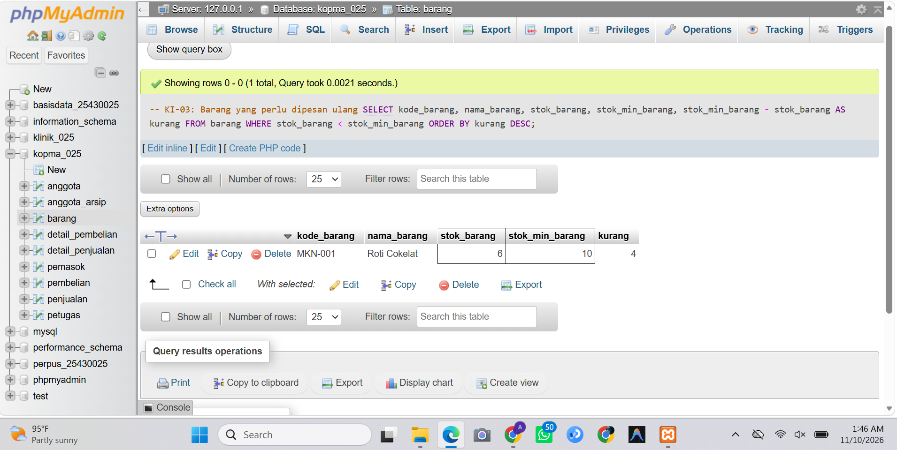

Keterangan: `<=` dipakai karena yang dicari adalah stok yang sudah *mencapai* atau di bawah batas minimum.

**KI-05: Jumlah pasien yang diperiksa setiap dokter**

```sql
SELECT kode_dokter, COUNT(DISTINCT no_pasien) AS jumlah_pasien
FROM pemeriksaan
GROUP BY kode_dokter
ORDER BY kode_dokter;
```


Keterangan: pemeriksaan dikelompokkan per dokter lalu dihitung pasien uniknya. Nama dokter memerlukan `JOIN` dengan tabel `dokter`.

### 6.2 Latihan Penyaringan dan Fungsi per Baris

**P07-11: LIKE (pasien dengan nama mengandung huruf a)**

```sql
SELECT no_pasien, nama_pasien, tanggal_lahir, alamat
FROM pasien
WHERE nama_pasien LIKE '%a%'
ORDER BY nama_pasien ASC;
```

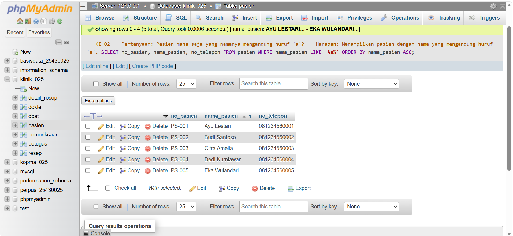

**BETWEEN (pemeriksaan 1 sampai 3 Oktober 2026)**

```sql
SELECT no_pemeriksaan, no_pasien, tanggal_pemeriksaan, diagnosis
FROM pemeriksaan
WHERE DATE(tanggal_pemeriksaan) BETWEEN '2026-10-01' AND '2026-10-03'
ORDER BY tanggal_pemeriksaan;
```

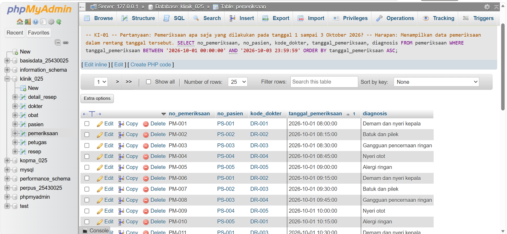

Keterangan: `DATE()` dipakai agar pemeriksaan pada 3 Oktober tetap tampil walaupun tersimpan lengkap dengan jam.

**IN (pasien PS-001, PS-002, PS-003)**

```sql
SELECT no_pasien, nama_pasien, tanggal_lahir
FROM pasien
WHERE no_pasien IN ('PS-001', 'PS-002', 'PS-003');
```

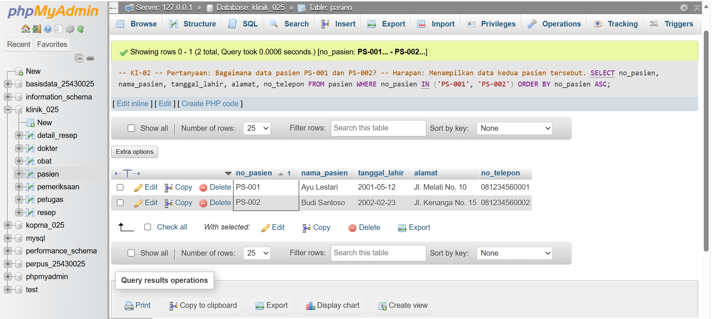

**IS NULL (pasien tanpa nomor telepon)**

```sql
SELECT no_pasien, nama_pasien, no_telepon
FROM pasien
WHERE no_telepon IS NULL;
```

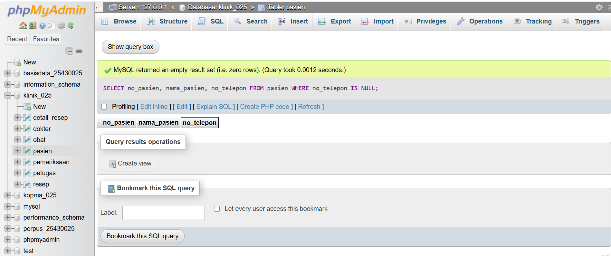

**CASE dan CONCAT (kategori umur pasien)**

```sql
SELECT
    no_pasien, nama_pasien,
    CONCAT(YEAR(CURDATE()) - YEAR(tanggal_lahir), ' tahun') AS umur,
    CASE
        WHEN YEAR(CURDATE()) - YEAR(tanggal_lahir) < 18 THEN 'Anak-anak'
        WHEN YEAR(CURDATE()) - YEAR(tanggal_lahir) < 60 THEN 'Dewasa'
        ELSE 'Lansia'
    END AS kategori_umur
FROM pasien;
```

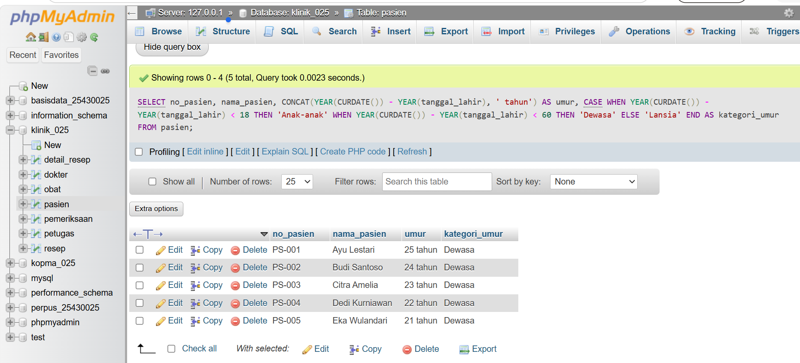

Keterangan: umur dihitung dari selisih tahun, lalu dikelompokkan menjadi anak-anak (di bawah 18), dewasa (18 sampai 59), dan lansia (60 ke atas).

## 7. Pembahasan dan Kendala

**Pembahasan**

1. Alias kolom dapat dipakai di `ORDER BY` tetapi tidak di `WHERE`, karena `WHERE` diproses sebelum `SELECT`. Solusinya menulis ulang perhitungan di `WHERE`.
2. Pada kolom bertanggal, `BETWEEN` perlu diwaspadai bila kolomnya bertipe DATETIME. Pada kueri Klinik hal ini diatasi dengan `DATE()`, sedangkan pada KI-05 Kopma batas atas dapat dibuat `< '2026-10-01'`.
3. Latihan 2A menunjukkan bahwa kueri bisa berjalan tanpa galat tetapi hasilnya salah, karena prioritas `AND` lebih tinggi daripada `OR`. Tanda kurung pada 2B memperbaikinya.
4. Perhitungan umur pada kueri Klinik memakai selisih tahun, sehingga bisa lebih besar satu tahun bila ulang tahun belum lewat. `TIMESTAMPDIFF(YEAR, tanggal_lahir, CURDATE())` lebih akurat.
5. KI-02, KI-03, dan KI-05 Klinik memerlukan `JOIN` agar nama pasien, dokter, dan obat dapat ditampilkan.

**Kendala**
Selama praktikum, terdapat beberapa kendala yang dialami, yaitu:

1. Beberapa kueri perlu disesuaikan kembali karena nama tabel dan kolom harus sesuai dengan struktur database yang digunakan.
2. Pada praktik Klinik Mutiara, saya perlu memeriksa struktur tabel terlebih dahulu agar tidak salah menggunakan nama kolom dalam kueri.
3. Beberapa kebutuhan informasi, seperti informasi obat dalam resep dan jumlah pasien per dokter, belum dapat ditampilkan secara lengkap karena membutuhkan penggabungan tabel menggunakan `JOIN`.
4. Saya perlu menyesuaikan kondisi pencarian menggunakan `LIKE`, `BETWEEN`, `IN`, dan `IS NULL` agar hasil yang ditampilkan sesuai dengan kebutuhan.
5. Pada saat menyusun laporan, saya perlu mencocokkan nama file screenshot dengan nama gambar yang digunakan dalam Markdown agar bukti praktik dapat ditampilkan dengan benar.

**Cara mengatasi:** Saya memeriksa struktur tabel menggunakan `DESCRIBE`, memperbaiki penulisan kueri sesuai kolom yang tersedia, serta menjalankan kueri kembali untuk memastikan hasilnya sesuai.

## 8. Kesimpulan

1. Proyeksi dan penyaringan membatasi kolom dan baris yang ditampilkan. Operator `IN`, `BETWEEN`, `LIKE`, dan `IS NULL` menyederhanakan kondisi yang sering dipakai.
2. Urutan pemrosesan `FROM`, `WHERE`, `SELECT`, `ORDER BY` menjelaskan perilaku alias.
3. NULL harus diuji dengan `IS NULL` atau `IS NOT NULL`.
4. Kondisi campuran `AND` dan `OR` perlu diberi tanda kurung agar sesuai maksud.
5. Fungsi per baris menghasilkan satu nilai per baris, berbeda dengan fungsi agregat yang merangkum banyak baris.
6. Pada proyek Klinik Mutiara, kebutuhan informasi yang melibatkan beberapa tabel dilanjutkan dengan `JOIN`.

## 9. Pernyataan Penggunaan AI

Dalam pengerjaan praktikum Modul 7, saya menggunakan AI sebagai alat bantu untuk memahami materi SQL, membantu menyusun dan memperbaiki penulisan kueri, serta merapikan laporan praktikum.

Seluruh praktik menjalankan kueri dan pemeriksaan hasil dilakukan sendiri menggunakan phpMyAdmin pada database Kopma dan Klinik Mutiara. Hasil praktik diperiksa kembali sebelum dimasukkan ke dalam laporan.

### 10. Bukti Git

Repositori: https://github.com/mutiaraichayani-dotcom/basisdata-25430025

Berkas kueri: `p07_kueri_kopma_25430025.sql`dan `p07_kueri_25430025.sql`
